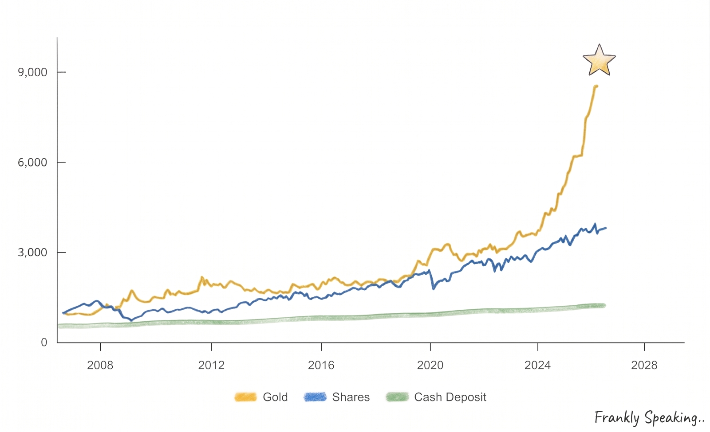

```{r setup, include=FALSE, echo=FALSE, message=FALSE, warning=FALSE}
knitr::opts_chunk$set(
  echo = FALSE,
  message = FALSE,
  warning = FALSE,
  dpi = 300
)

library(dplyr)
library(ggplot2)
library(knitr)
library(lubridate)
library(purrr)
library(readr)
library(scales)
library(tibble)
library(tidyr)

source(file.path("scripts", "model.R"))
model <- build_model_outputs("files")
validate_model_outputs(model)

sm <- model$summary_metrics
monthly <- model$asset_performance_monthly
wide <- model$asset_performance_wide
events <- model$historical_events
cpi_sum <- model$cpi_summary
wu_sum <- model$stw_whole_unit

row_metric <- function(variant, col) {
  sm[[col]][[which(sm$series_variant == variant)]]
}

fmt_aud <- function(x, digits = 2L) {
  sprintf("AUD %s", formatC(x, format = "f", digits = digits, big.mark = ","))
}

fmt_num <- function(x, digits = 2L) {
  formatC(x, format = "f", digits = digits, big.mark = ",")
}

fmt_pct <- function(x, digits = 2L) {
  sprintf("%s%%", formatC(x, format = "f", digits = digits))
}

palette_main <- c(
  "Gold (AUD Spot)" = "#c88a00",
  "STW Total Return (Fractional DRP)" = "#1771ad",
  "Fixed Interest (Bonus Savings)" = "#2e7d6b",
  "STW Price-Only" = "#7f8c8d"
)

linetypes_main <- c(
  "Gold (AUD Spot)" = "solid",
  "STW Total Return (Fractional DRP)" = "solid",
  "Fixed Interest (Bonus Savings)" = "solid",
  "STW Price-Only" = "dashed"
)

sizes_main <- c(
  "Gold (AUD Spot)" = 0.95,
  "STW Total Return (Fractional DRP)" = 0.95,
  "Fixed Interest (Bonus Savings)" = 0.95,
  "STW Price-Only" = 0.70
)

base_chart_theme <- function() {
  theme_minimal(base_size = 10.5) +
    theme(
      panel.grid.major.x = element_blank(),
      panel.grid.minor = element_blank(),
      panel.grid.major.y = element_line(colour = "#e4e7eb", linewidth = 0.4),
      plot.title = element_text(
        face = "bold",
        colour = "#1f2933",
        margin = margin(b = 4)
      ),
      plot.subtitle = element_text(
        colour = "#52606d",
        size = 9.2,
        margin = margin(b = 10)
      ),
      plot.caption = element_text(
        colour = "#616e7c",
        size = 8.0,
        hjust = 0,
        margin = margin(t = 8)
      ),
      legend.position = "bottom",
      legend.title = element_blank(),
      strip.text = element_text(
        face = "bold",
        colour = "#1f2933",
        hjust = 0,
        size = 10
      ),
      axis.title = element_blank()
    )
}

gold_end <- row_metric("gold_aud", "end_value_nominal_aud")
gold_real <- row_metric("gold_aud", "end_value_real_aud")
gold_cagr <- row_metric("gold_aud", "cagr_pct")
gold_mdd <- row_metric("gold_aud", "max_drawdown_pct")
gold_vol <- row_metric("gold_aud", "annual_volatility_pct")

gold_015_end <- row_metric("gold_etf_015", "end_value_nominal_aud")
gold_040_end <- row_metric("gold_etf_040", "end_value_nominal_aud")

stw_tr_end <- row_metric("stw_total_return", "end_value_nominal_aud")
stw_tr_real <- row_metric("stw_total_return", "end_value_real_aud")
stw_tr_cagr <- row_metric("stw_total_return", "cagr_pct")
stw_tr_mdd <- row_metric("stw_total_return", "max_drawdown_pct")
stw_tr_vol <- row_metric("stw_total_return", "annual_volatility_pct")

stw_px_end <- row_metric("stw_price_only", "end_value_nominal_aud")
stw_px_real <- row_metric("stw_price_only", "end_value_real_aud")
stw_px_cagr <- row_metric("stw_price_only", "cagr_pct")
stw_px_mdd <- row_metric("stw_price_only", "max_drawdown_pct")

fi_end <- row_metric("fixed_interest_bonus", "end_value_nominal_aud")
fi_real <- row_metric("fixed_interest_bonus", "end_value_real_aud")
fi_cagr <- row_metric("fixed_interest_bonus", "cagr_pct")

td_end <- row_metric("fixed_interest_td_1y", "end_value_nominal_aud")
td_cagr <- row_metric("fixed_interest_td_1y", "cagr_pct")

cash_end <- row_metric("fixed_interest_cash", "end_value_nominal_aud")
cash_cagr <- row_metric("fixed_interest_cash", "cagr_pct")

gold_aud_peak_idx <- which.max(wide$gold_value_aud)
gold_aud_peak_val <- wide$gold_value_aud[[gold_aud_peak_idx]]
gold_aud_peak_oz <- wide$gold_aud[[gold_aud_peak_idx]]
gold_aud_peak_date <- format(wide$date[[gold_aud_peak_idx]], "%B %Y")
gold_2026_dd <- (gold_end / gold_aud_peak_val - 1) * 100

gold_feb_idx <- which(wide$date == as.Date("2026-02-01"))
gold_feb_oz <- wide$gold_aud[[gold_feb_idx]]

cpi_start <- cpi_sum$start_index
cpi_end <- cpi_sum$end_index
cpi_ratio <- cpi_sum$ratio
cpi_cum_pct <- cpi_sum$cum_pct
cpi_breakeven <- cpi_sum$breakeven_aud

wu_frac_units <- wu_sum$fractional_end_units
wu_frac_end <- wu_sum$fractional_end_aud
wu_end_units <- wu_sum$end_units
wu_res_cash <- wu_sum$residual_cash_aud
wu_end_val <- wu_sum$end_value_aud
wu_gap <- wu_sum$gap_vs_fractional_aud
wu_gap_pct <- wu_gap / wu_frac_end * 100
```

Put AUD 1,000 into three everyday Australian asset classes in July 2006, walk
away for twenty years, and return in July 2026. On a gross pre-tax basis, spot
gold finishes ahead at **`r fmt_aud(gold_end)`** (`r fmt_pct(gold_cagr)` p.a.),
Australian shares via the SPDR S&P/ASX 200 Fund (`ASX:STW`) with reinvested
distributions reach **`r fmt_aud(stw_tr_end)`** (`r fmt_pct(stw_tr_cagr)`
p.a.), and retail bonus savings accounts rolled over annually grow to
**`r fmt_aud(fi_end)`** (`r fmt_pct(fi_cagr)` p.a.).

Those headline numbers flip several intuitive assumptions once fees, dividends,
inflation, and Australian tax enter the frame. Leave dividends uninvested and
`ASX:STW` shrinks to **`r fmt_aud(stw_px_end)`** (`ASX:STW` Price-Only), losing
to consumer price inflation after **`r fmt_num(cpi_breakeven)`** AUD is needed
just to preserve June 2006 purchasing power. Add Australian personal income tax
and retail deposits slip below inflation in real terms despite never suffering
a single negative month on screen.

This article tests all three assets on a strictly comparable AUD 1,000 baseline
across `r nrow(wide)` monthly observations from July 2006 to July 2026,
unpacks the currency and interest-rate shocks behind each turn in the curves,
and quantifies what management fees, dividend reinvestment mechanics, and
Australian Taxation Office (ATO) rules take off the top.

> **General Educational Information:** This analysis examines historical
> market, commodity, and Reserve Bank of Australia (RBA) data for educational
> and reproducible engineering purposes. It does not constitute personal
> financial, investment, or tax advice under Australian law. Consider your own
> financial objectives and seek qualified licensed advice before making
> investment decisions.

## Headline Results: Twenty Years in One Table

Before diving into methodologies and macroeconomic regimes, Table 1 summarises
what AUD 1,000 in July 2006 grew to by July 2026 before tax and inflation
(measured against Australian Bureau of Statistics Consumer Price Index, ABS
CPI, ratio `r formatC(cpi_ratio, format = "f", digits = 5)` across June 2006 to
June 2026).

```{r headline-table}
headline_variants <- c(
  "gold_aud",
  "gold_etf_015",
  "gold_etf_040",
  "stw_total_return",
  "stw_total_return_whole_unit",
  "stw_price_only",
  "fixed_interest_td_1y",
  "fixed_interest_bonus",
  "fixed_interest_cash"
)

variant_labels <- c(
  gold_aud = "Gold (AUD Spot, Gross)",
  gold_etf_015 = "Gold ETF Sensitivity (0.15% MER)",
  gold_etf_040 = "Gold ETF Sensitivity (0.40% MER)",
  stw_total_return = "ASX:STW Total Return (Fractional DRP)",
  stw_total_return_whole_unit = "ASX:STW Total Return (Whole-Unit DRP)",
  stw_price_only = "ASX:STW Price-Only (No Dividends)",
  fixed_interest_td_1y = "Fixed Interest (1-Year Term Deposit)",
  fixed_interest_bonus = "Fixed Interest (Bonus Savings Rollover)",
  fixed_interest_cash = "Fixed Interest (RBA Cash Rate Floor)"
)

headline_df <- tibble(series_variant = headline_variants) |>
  left_join(sm, by = "series_variant") |>
  transmute(
    Benchmark = unname(variant_labels[.data$series_variant]),
    `End AUD` = fmt_num(.data$end_value_nominal_aud),
    `Real AUD` = fmt_num(.data$end_value_real_aud),
    `CAGR` = fmt_pct(.data$cagr_pct),
    `Vol. p.a.` = fmt_pct(.data$annual_volatility_pct),
    `Max DD` = fmt_pct(.data$max_drawdown_pct)
  )

kable(
  headline_df,
  align = c("l", "r", "r", "r", "r", "r"),
  caption = paste(
    "Performance of AUD 1,000 invested from July 2006 to July 2026",
    "(all dollar values in AUD, pre-tax; Real column deflated to constant",
    "June 2006 AUD via ABS CPI)."
  )
)
```

Three structural findings jump straight off Table 1:

- **Dividends drive equity wealth:** Reinvesting all `60` eligible cash
  distributions lifts `ASX:STW` from **`r fmt_aud(stw_px_end)`** (Price-Only)
  to **`r fmt_aud(stw_tr_end)`** (Fractional DRP), accounting for nearly
  four-fifths of total equity gains above principal.
- **Gold's surge came with a deep decade-long detour:** Spot gold reached
  `r fmt_pct(gold_cagr)` p.a. compound annual growth rate (CAGR) largely on the
  strength of its 2024--2026 breakout, after trailing equities for years inside
  a `r fmt_pct(gold_mdd)` drawdown.
- **Cash stability stops short of purchasing power:** Bonus savings accounts
  never lost a cent in nominal value, yet pre-tax real wealth finished at just
  **`r fmt_aud(fi_real)`** (`+11.3%` real over twenty years) before income tax
  was deducted.

## Methodology and Fairness Rules

Long-horizon comparisons easily go astray when authors mix currencies, drop
dividends, or cherry-pick start dates. This study locks in four fairness rules
across all `241` monthly observations (`2006-07-01` to `2026-07-01`, governed
by the full history of the `ASX:STW` monthly price series):

1. **Single Currency:** All valuations sit in nominal Australian dollars (AUD).
   World Bank USD gold spot prices convert monthly into AUD via official RBA
   Table F11 `AUD/USD` exchange rates (`FXRUSD`: `gold_usd / aud_usd`).
2. **Identical Horizon:** Every series begins at exactly AUD 1,000.00 in July
   2006 (`2006-07-01`) and closes in July 2026 (`2026-07-01`).
3. **Reinvestment Parity:** Zero-yield Gold (price growth alone) is compared
   against compounded Fixed Interest and reinvested-distribution Equities
   (`ASX:STW` Total Return on a Fractional Cash Dividend Reinvestment Plan,
   or DRP, alongside a practical Whole-Unit DRP sensitivity).
4. **Transparent Boundary Disclosures:** Primary charts display nominal pre-tax
   AUD values so readers can separate raw market returns from fund Management
   Expense Ratios (MER), personal marginal tax rates, and inflation.

### Explicit Data Definitions and Observation Timing

Each public dataset uses a slightly different reporting cadence, documented
upfront so readers understand exact boundary assumptions:

- **Gold (`gold_aud`, `gold_etf_015`, `gold_etf_040`):** World Bank *Pink
  Sheet* monthly prices represent daily-average spot (formerly London afternoon
  fixing monthly mean) in USD per troy ounce, converted using RBA Table F11
  month-end `FXRUSD` exchange rates. Net-of-MER sensitivities apply continuous
  fee drag `V_t * (1 - MER)^(t / 12)` at `0.15%` p.a. (`ASX:PMGOLD`) and
  `0.40%` p.a. (`ASX:GOLD`).
- **Fixed Interest (`fixed_interest_bonus`, `fixed_interest_td_1y`,
  `fixed_interest_cash`):** Monthly advertised rates from RBA Table F4
  (`FRDIRSAB10K` bonus savings for AUD 10,000 balances and `FRDIRBTD10K1Y`
  1-year term deposits) apply via **Annual Rollover**. At each July from 2006
  to 2025 (`20` twelve-month terms), July's rate is locked for 12 months,
  accruing linearly intra-year and compounding principal plus interest at each
  July maturity. RBA Table F1.1 monthly average Cash Rate Target (`FIRMMCRT`)
  provides a monthly-compounded policy floor.
- **Australian Equities (`ASX:STW`):** Monthly bar closes from Investing.com
  Australia (`AUD 49.19` in July 2006, open `AUD 50.00`, to `AUD 80.22` in July
  2026; `0.106%` mean absolute spread across all `241` months versus official
  State Street Global Advisors, SSGA, daily Net Asset Value history). Sixty
  eligible distributions (`ex_dividend_date` in `2006-07-01` through
  `2026-07-31`) reinvest on `floor_date(payment_date, "month")`. Franking
  credits are excluded from pre-tax charts and isolated in the ATO after-tax
  model.
- **Consumer Price Inflation (`abs-cpi.csv`):** RBA / ABS Table G1 quarterly
  all-groups CPI (`GCPIAG`, index base September 2025 = `100`) moves from
  **`r cpi_start`** (`30 June 2006`) to **`r cpi_end`** (`30 June 2026`). Using
  the exact uninterpolated June-to-June ratio of
  **`r formatC(cpi_ratio, format = "f", digits = 5)`**
  (+`r fmt_pct(cpi_cum_pct, 2)` cumulative inflation; `2.73%` p.a.), a basket
  costing AUD 1,000 in June 2006 requires **`r fmt_aud(cpi_breakeven)`** in
  June 2026.

> **Verification Caveat on `ASX:STW` Franking:** Cross-checking our `62`-row
> distribution schedule against SSGA's official 2014--2026 table confirms
> `46 / 46` exact matches on cash payouts and payment dates. Headline franking
> percentages differ on `17` rows (most notably `2019-06-27`, shown at `0.00%`
> headline franking versus `AUD 0.1923` per-unit franking credits published by
> SSGA), which slightly understates `ASX:STW` after-tax franking offsets.

## Twenty Years of Performance (2006--2026)

```{r chart1-linear, fig.width=9, fig.height=5.5, fig.cap="Chart 1: Growth of AUD 1,000 across Gold, Fixed Interest and ASX:STW (Linear Scale)."}
plot_df <- monthly |>
  filter(.data$series_variant %in% c(
    "gold_aud",
    "stw_total_return",
    "fixed_interest_bonus",
    "stw_price_only"
  )) |>
  mutate(
    display_name = recode(
      .data$series_variant,
      gold_aud = "Gold (AUD Spot)",
      stw_total_return = "STW Total Return (Fractional DRP)",
      fixed_interest_bonus = "Fixed Interest (Bonus Savings)",
      stw_price_only = "STW Price-Only"
    ),
    display_name = factor(
      .data$display_name,
      levels = names(palette_main)
    )
  )

tier1_events <- events |>
  filter(.data$chart_priority == 1L) |>
  mutate(
    mid_date = .data$date + (.data$end_date - .data$date) / 2,
    y_linear = c(4600, 6100, 5200, 7100, 9150),
    y_log = c(2950, 5300, 4800, 6800, 10200)
  )

end_pts <- plot_df |>
  filter(.data$date == as.Date("2026-07-01")) |>
  mutate(
    label_text = sprintf(
      "%s\n%s",
      c(
        "Gold (AUD Spot)" = "Gold Spot",
        "STW Total Return (Fractional DRP)" = "STW Total Return",
        "Fixed Interest (Bonus Savings)" = "Bonus Savings",
        "STW Price-Only" = "STW Price-Only"
      )[as.character(.data$display_name)],
      fmt_aud(.data$value_aud, 0L)
    ),
    y_lin = case_when(
      .data$series_variant == "fixed_interest_bonus" ~ 2300,
      .data$series_variant == "stw_price_only" ~ 1220,
      TRUE ~ .data$value_aud
    ),
    y_log = case_when(
      .data$series_variant == "fixed_interest_bonus" ~ 2280,
      .data$series_variant == "stw_price_only" ~ 1340,
      TRUE ~ .data$value_aud
    )
  )

p1 <- ggplot(
  plot_df,
  aes(
    x = .data$date,
    y = .data$value_aud,
    colour = .data$display_name,
    linetype = .data$display_name,
    linewidth = .data$display_name
  )
) +
  geom_rect(
    data = tier1_events,
    aes(xmin = .data$date, xmax = .data$end_date, ymin = -Inf, ymax = Inf),
    inherit.aes = FALSE,
    fill = "#e6eef5",
    alpha = 0.55
  ) +
  geom_hline(
    yintercept = cpi_sum$breakeven_aud,
    linetype = "dotted",
    colour = "#9aa5b1",
    linewidth = 0.45
  ) +
  geom_line() +
  geom_segment(
    data = end_pts,
    aes(
      x = as.Date("2026-07-01"),
      xend = as.Date("2026-11-15"),
      y = .data$value_aud,
      yend = .data$y_lin,
      colour = .data$display_name
    ),
    inherit.aes = FALSE,
    linewidth = 0.35,
    show.legend = FALSE
  ) +
  geom_text(
    data = end_pts,
    aes(
      x = as.Date("2026-12-01"),
      y = .data$y_lin,
      label = .data$label_text,
      colour = .data$display_name
    ),
    inherit.aes = FALSE,
    hjust = 0,
    size = 2.9,
    lineheight = 0.92,
    fontface = "bold",
    show.legend = FALSE
  ) +
  geom_text(
    data = tier1_events,
    aes(x = .data$mid_date, y = .data$y_linear, label = .data$short_label),
    inherit.aes = FALSE,
    size = 2.6,
    colour = "#3e4c59",
    fontface = "italic"
  ) +
  annotate(
    "text",
    x = as.Date("2006-09-01"),
    y = cpi_sum$breakeven_aud + 230,
    label = "CPI breakeven (AUD 1,715)",
    hjust = 0,
    size = 2.6,
    colour = "#616e7c"
  ) +
  scale_colour_manual(values = palette_main) +
  scale_linetype_manual(values = linetypes_main) +
  scale_linewidth_manual(values = sizes_main) +
  scale_y_continuous(
    labels = label_dollar(prefix = "AUD "),
    breaks = seq(0, 9000, by = 1500),
    limits = c(0, 9600)
  ) +
  scale_x_date(
    date_breaks = "2 years",
    date_labels = "%Y",
    limits = c(as.Date("2006-07-01"), as.Date("2030-03-01")),
    expand = expansion(mult = c(0.01, 0.02))
  ) +
  labs(
    title = "Growth of AUD 1,000 Across Australian Asset Classes (2006\u20132026)",
    subtitle = paste(
      "Nominal pre-tax AUD, monthly July 2006 to July 2026;",
      "gross of personal tax, brokerage and Gold ETF MER"
    ),
    caption = paste(
      "Sources: World Bank Pink Sheet (Gold), RBA Tables F4 & F11,",
      "Investing.com AU / InvestSMART (ASX:STW), ABS CPI."
    )
  ) +
  base_chart_theme()

p1
```

Looking at Chart 1 on a linear dollar scale captures the sheer drama of gold's
2024--2026 rally, when USD gold hit a February 2026 peak (`USD 5,020/oz`,
`r fmt_aud(gold_feb_oz)`/oz), local AUD weakness lifted AUD gold to its
`r gold_aud_peak_date` record (**`r fmt_aud(gold_aud_peak_val)`** indexed, or
`r fmt_aud(gold_aud_peak_oz)`/oz), and July 2026 closed at
**`r fmt_aud(gold_end)`**. Yet linear axes flatten earlier compounding across
2006--2019. Chart 2 puts identical trajectories on a base-10 log scale so
equal vertical gaps show equal percentage multipliers.

```{r chart2-log, fig.width=9, fig.height=5.5, fig.cap="Chart 2: Growth of AUD 1,000 on a Log10 Scale showing equal percentage multipliers across 2006--2026."}
p2 <- ggplot(
  plot_df,
  aes(
    x = .data$date,
    y = .data$value_aud,
    colour = .data$display_name,
    linetype = .data$display_name,
    linewidth = .data$display_name
  )
) +
  geom_rect(
    data = tier1_events,
    aes(xmin = .data$date, xmax = .data$end_date, ymin = 480, ymax = 12200),
    inherit.aes = FALSE,
    fill = "#e6eef5",
    alpha = 0.55
  ) +
  geom_hline(
    yintercept = cpi_sum$breakeven_aud,
    linetype = "dotted",
    colour = "#9aa5b1",
    linewidth = 0.45
  ) +
  geom_line() +
  geom_segment(
    data = end_pts,
    aes(
      x = as.Date("2026-07-01"),
      xend = as.Date("2026-11-15"),
      y = .data$value_aud,
      yend = .data$y_log,
      colour = .data$display_name
    ),
    inherit.aes = FALSE,
    linewidth = 0.35,
    show.legend = FALSE
  ) +
  geom_text(
    data = end_pts,
    aes(
      x = as.Date("2026-12-01"),
      y = .data$y_log,
      label = .data$label_text,
      colour = .data$display_name
    ),
    inherit.aes = FALSE,
    hjust = 0,
    size = 2.9,
    lineheight = 0.92,
    fontface = "bold",
    show.legend = FALSE
  ) +
  geom_text(
    data = tier1_events,
    aes(x = .data$mid_date, y = .data$y_log, label = .data$short_label),
    inherit.aes = FALSE,
    size = 2.6,
    colour = "#3e4c59",
    fontface = "italic"
  ) +
  scale_colour_manual(values = palette_main) +
  scale_linetype_manual(values = linetypes_main) +
  scale_linewidth_manual(values = sizes_main) +
  scale_y_log10(
    labels = label_dollar(prefix = "AUD ", accuracy = 1),
    breaks = c(500, 1000, 2000, 4000, 8000),
    limits = c(480, 12200)
  ) +
  scale_x_date(
    date_breaks = "2 years",
    date_labels = "%Y",
    limits = c(as.Date("2006-07-01"), as.Date("2030-03-01")),
    expand = expansion(mult = c(0.01, 0.02))
  ) +
  labs(
    title = "Compound Growth Trajectory (Log10 Scale, 2006\u20132026)",
    subtitle = paste(
      "Equal vertical intervals represent identical percentage gains;",
      "reveals pre-2020 drawdown and compounding dynamics"
    ),
    caption = paste(
      "Note: Log scale highlights STW Total Return pulling ahead of Spot",
      "Gold across 2017\u20132019 before Gold's pandemic and central-bank",
      "rallies."
    )
  ) +
  base_chart_theme()

p2
```

Notice what Chart 2 reveals that linear charts obscure:

- **Equities cratered while gold rallied during the Global Financial Crisis:**
  Between late 2007 and February 2009 (`EVT-01`), `ASX:STW` fell to
  `AUD 31.40` (Price-Only `r fmt_aud(638, 0)`), while aggressive RBA cuts
  from `7.25%` to `3.00%` weakened the Australian dollar (`0.6454`), turning
  moderate USD gold demand into a sharp AUD gold surge (`AUD 1,461/oz`).
- **A surging Australian dollar capped local gold gains in 2010--2011:**
  During `EVT-02`, USD gold struck crisis highs (`USD 1,759/oz` in August
  2011), yet because `AUD/USD` traded above parity (`1.0691`), AUD gold stalled
  around `AUD 1,645/oz` (`AUD 1,987` indexed) while RBA rate hikes lifted term
  deposits and bonus savings.
- **Compounding equities overtook gold before the pandemic:** After a sluggish
  2013--2015 bear phase for gold and low 2016--2019 yields for savers,
  reinvested dividends allowed `ASX:STW` Total Return to match and briefly lead
  spot gold entering 2019.
- **Ultra-low rates stalled cash while inflation revived rate hikes:** COVID-19
  emergency easing (`EVT-04`) pushed RBA cash rates to `0.11%` and locked July
  2021 bonus savings at `0.35%` (bottoming at `0.25%` in October 2021). Then
  post-pandemic tightening (`EVT-05`) swung bonus savings back up to `4.90%` by
  November 2023 while `ASX:STW` delivered a record `AUD 1.9401` per-unit June
  2022 distribution.

### Inside Each Asset Class: Sensitivities and Currency Mechanics

Aggregate hero charts hide crucial internal mechanics within each asset class:
ETF fee drag and USD/AUD currency translation in Gold, product choice across
deposits in Fixed Interest, and Fractional vs Whole-Unit DRP execution in
`ASX:STW`. Chart 3 isolates each asset class across stacked panels.

```{r chart3-small-multiples, fig.width=9, fig.height=8.6, fig.cap="Chart 3: Asset-class small multiples detailing Gold ETF MER drag and USD parity divergence, Fixed Interest benchmarks, and ASX:STW DRP execution."}
facet_levels <- c(
  "Gold: AUD Spot, Gold ETF MER Band and Indexed USD Gold",
  "Fixed Interest: Bonus Savings, 1-Year Term Deposit & Cash Floor",
  "Australian Equities (ASX:STW): Fractional DRP, Whole-Unit DRP & Price-Only"
)

gold_usd_idx <- 1000 * wide$gold_usd / wide$gold_usd[[1L]]

gold_panel <- tibble(
  date = rep(wide$date, times = 4L),
  facet = factor(facet_levels[[1L]], levels = facet_levels),
  series = rep(
    c(
      "Gold Spot (AUD)",
      "PMGOLD (0.15% MER)",
      "GOLD (0.40% MER)",
      "USD Gold Index"
    ),
    each = nrow(wide)
  ),
  value_aud = c(
    wide$gold_value_aud,
    wide$gold_etf_015_value_aud,
    wide$gold_etf_040_value_aud,
    gold_usd_idx
  )
)

fi_panel <- tibble(
  date = rep(wide$date, times = 3L),
  facet = factor(facet_levels[[2L]], levels = facet_levels),
  series = rep(
    c("1-Year Term Deposit", "Bonus Savings Rollover", "RBA Cash Rate Floor"),
    each = nrow(wide)
  ),
  value_aud = c(
    wide$td_1y_value_aud,
    wide$fixed_interest_value_aud,
    wide$cash_value_aud
  )
)

stw_wu_vals <- monthly |>
  filter(.data$series_variant == "stw_total_return_whole_unit") |>
  arrange(.data$date) |>
  pull(.data$value_aud)

stw_panel <- tibble(
  date = rep(wide$date, times = 3L),
  facet = factor(facet_levels[[3L]], levels = facet_levels),
  series = rep(
    c("STW Fractional DRP", "STW Whole-Unit DRP", "STW Price-Only"),
    each = nrow(wide)
  ),
  value_aud = c(
    wide$stw_tr_value_aud,
    stw_wu_vals,
    wide$stw_price_value_aud
  )
)

sm_df <- bind_rows(gold_panel, fi_panel, stw_panel)

gold_ribbon <- tibble(
  date = wide$date,
  facet = factor(facet_levels[[1L]], levels = facet_levels),
  ymin = wide$gold_etf_040_value_aud,
  ymax = wide$gold_value_aud
)

sm_colours <- c(
  "Gold Spot (AUD)" = "#c88a00",
  "PMGOLD (0.15% MER)" = "#9c6b00",
  "GOLD (0.40% MER)" = "#6b4700",
  "USD Gold Index" = "#7f8c8d",
  "1-Year Term Deposit" = "#1f5a4d",
  "Bonus Savings Rollover" = "#2e7d6b",
  "RBA Cash Rate Floor" = "#5c9e8f",
  "STW Fractional DRP" = "#1771ad",
  "STW Whole-Unit DRP" = "#4596cc",
  "STW Price-Only" = "#7f8c8d"
)

sm_linetypes <- c(
  "Gold Spot (AUD)" = "solid",
  "PMGOLD (0.15% MER)" = "dashed",
  "GOLD (0.40% MER)" = "dotdash",
  "USD Gold Index" = "dotted",
  "1-Year Term Deposit" = "dashed",
  "Bonus Savings Rollover" = "solid",
  "RBA Cash Rate Floor" = "dotted",
  "STW Fractional DRP" = "solid",
  "STW Whole-Unit DRP" = "dotted",
  "STW Price-Only" = "dashed"
)

sm_end_labels <- sm_df |>
  filter(.data$date == as.Date("2026-07-01")) |>
  mutate(
    short_tag = c(
      "Gold Spot (AUD)" = "AUD Spot",
      "PMGOLD (0.15% MER)" = "ETF 0.15%",
      "GOLD (0.40% MER)" = "ETF 0.40%",
      "USD Gold Index" = "USD Gold",
      "1-Year Term Deposit" = "1-Yr TD",
      "Bonus Savings Rollover" = "Bonus Sav.",
      "RBA Cash Rate Floor" = "Cash Rate",
      "STW Fractional DRP" = "Frac. DRP",
      "STW Whole-Unit DRP" = "Whole-Unit",
      "STW Price-Only" = "Price-Only"
    )[.data$series],
    label_txt = sprintf("%s: %s", .data$short_tag, fmt_aud(.data$value_aud, 0L)),
    y_pos = case_when(
      .data$series == "Gold Spot (AUD)" ~ 8250,
      .data$series == "PMGOLD (0.15% MER)" ~ 6850,
      .data$series == "GOLD (0.40% MER)" ~ 5450,
      .data$series == "USD Gold Index" ~ 4100,
      .data$series == "1-Year Term Deposit" ~ 2090,
      .data$series == "Bonus Savings Rollover" ~ 1880,
      .data$series == "RBA Cash Rate Floor" ~ 1660,
      .data$series == "STW Fractional DRP" ~ 4180,
      .data$series == "STW Whole-Unit DRP" ~ 3420,
      .data$series == "STW Price-Only" ~ 1631,
      TRUE ~ .data$value_aud
    )
  )

tier2_bands <- tibble(
  xmin = as.Date(c("2010-10-01", "2013-04-01", "2013-04-01", "2016-06-01")),
  xmax = as.Date(c("2011-08-01", "2015-12-01", "2015-12-01", "2016-06-01")),
  facet = factor(
    c(facet_levels[[1L]], facet_levels[[1L]], facet_levels[[2L]], facet_levels[[3L]]),
    levels = facet_levels
  )
)

sm_notes <- tibble(
  x = as.Date(c(
    "2010-10-01",
    "2015-01-01",
    "2014-08-01",
    "2021-01-01",
    "2016-06-01"
  )),
  y = c(4900, 4400, 1850, 1950, 3000),
  facet = factor(
    c(
      facet_levels[[1L]],
      facet_levels[[1L]],
      facet_levels[[2L]],
      facet_levels[[2L]],
      facet_levels[[3L]]
    ),
    levels = facet_levels
  ),
  label = c(
    "AUD parity caps\nAUD Gold (EVT-02)",
    "Falling AUD cushions\nUSD bear (EVT-03)",
    "RBA easing slows\ndeposit compounding",
    "0.35% July lock\n(COVID floor)",
    "Quarterly DRP starts\nJun 2016 (EVT-07)"
  )
)

p3 <- ggplot(
  sm_df,
  aes(
    x = .data$date,
    y = .data$value_aud,
    colour = .data$series,
    linetype = .data$series
  )
) +
  geom_rect(
    data = tier2_bands,
    aes(xmin = .data$xmin, xmax = .data$xmax, ymin = -Inf, ymax = Inf),
    inherit.aes = FALSE,
    fill = "#e6eef5",
    alpha = 0.6
  ) +
  geom_vline(
    data = tier2_bands |> filter(.data$xmin == .data$xmax),
    aes(xintercept = .data$xmin),
    inherit.aes = FALSE,
    linetype = "dashed",
    colour = "#7b8794",
    linewidth = 0.45
  ) +
  geom_ribbon(
    data = gold_ribbon,
    aes(x = .data$date, ymin = .data$ymin, ymax = .data$ymax),
    inherit.aes = FALSE,
    fill = "#c88a00",
    alpha = 0.18
  ) +
  geom_line(linewidth = 0.85) +
  geom_segment(
    data = sm_end_labels,
    aes(
      x = as.Date("2026-07-01"),
      xend = as.Date("2026-11-15"),
      y = .data$value_aud,
      yend = .data$y_pos,
      colour = .data$series
    ),
    inherit.aes = FALSE,
    linewidth = 0.35,
    show.legend = FALSE
  ) +
  geom_text(
    data = sm_end_labels,
    aes(
      x = as.Date("2026-12-01"),
      y = .data$y_pos,
      label = .data$label_txt,
      colour = .data$series
    ),
    inherit.aes = FALSE,
    hjust = 0,
    size = 2.75,
    fontface = "bold",
    show.legend = FALSE
  ) +
  geom_text(
    data = sm_notes,
    aes(x = .data$x, y = .data$y, label = .data$label),
    inherit.aes = FALSE,
    size = 2.55,
    colour = "#3e4c59",
    fontface = "italic"
  ) +
  facet_wrap(~ facet, ncol = 1, scales = "free_y") +
  scale_colour_manual(values = sm_colours) +
  scale_linetype_manual(values = sm_linetypes) +
  scale_y_continuous(
    labels = label_dollar(prefix = "AUD "),
    expand = expansion(mult = c(0.06, 0.12))
  ) +
  scale_x_date(
    date_breaks = "2 years",
    date_labels = "%Y",
    limits = c(as.Date("2006-07-01"), as.Date("2030-10-01")),
    expand = expansion(mult = c(0.01, 0.02))
  ) +
  labs(
    title = "Asset-Class Sensitivities, Fee Wedges and Currency Mechanics",
    subtitle = paste(
      "Panels isolate Gold MER & FX effects, Fixed Interest rate regimes,",
      "and ASX:STW DRP reinvestment realism"
    ),
    caption = paste(
      "Shaded Gold wedge spans gross AUD spot to 0.40% p.a. ETF MER.",
      "Note: USD Gold Index shows pure USD appreciation from AUD 1,000 base."
    )
  ) +
  base_chart_theme() +
  theme(legend.position = "none")

p3
```

### Downside Risk and Underwater Drawdowns

Headline ending balances tell only half the story; living through a `-50%`
slump takes real nerve. Chart 4 traces each curve's percentage decline below its
prior peak across the full twenty years, followed by the summary risk-return
metrics in Table 2.

```{r chart4-drawdown, fig.width=9, fig.height=5.0, fig.cap="Chart 4: Peak-to-trough underwater drawdown trajectories (%) for Gold, Fixed Interest and ASX:STW."}
p4 <- ggplot(
  plot_df,
  aes(
    x = .data$date,
    y = .data$drawdown_pct,
    colour = .data$display_name,
    linetype = .data$display_name,
    linewidth = .data$display_name
  )
) +
  geom_line() +
  annotate(
    "text",
    x = as.Date("2009-04-01"),
    y = -55.0,
    label = sprintf(
      "GFC Trough (Feb 2009)\nSTW TR %s | Price-Only %s",
      fmt_pct(stw_tr_mdd, 1L),
      fmt_pct(stw_px_mdd, 1L)
    ),
    hjust = 0,
    size = 2.65,
    colour = "#3e4c59",
    fontface = "italic"
  ) +
  annotate(
    "text",
    x = as.Date("2014-06-01"),
    y = -29.0,
    label = sprintf("Gold Bear Trough\nJun 2014: %s", fmt_pct(gold_mdd, 1L)),
    hjust = 0.5,
    size = 2.65,
    colour = "#8a5f00",
    fontface = "italic"
  ) +
  annotate(
    "text",
    x = as.Date("2020-03-01"),
    y = -32.0,
    label = "COVID-19\nMar 2020",
    hjust = 0.5,
    size = 2.65,
    colour = "#1771ad",
    fontface = "italic"
  ) +
  annotate(
    "text",
    x = as.Date("2026-07-01"),
    y = -23.0,
    label = sprintf("Gold Pullback\nJul 2026: %s", fmt_pct(gold_2026_dd, 1L)),
    hjust = 1,
    size = 2.65,
    colour = "#8a5f00",
    fontface = "italic"
  ) +
  scale_colour_manual(values = palette_main) +
  scale_linetype_manual(values = linetypes_main) +
  scale_linewidth_manual(values = sizes_main) +
  scale_y_continuous(
    labels = function(x) sprintf("%.0f%%", x),
    breaks = seq(-60, 0, by = 10),
    limits = c(-60, 3)
  ) +
  scale_x_date(
    date_breaks = "2 years",
    date_labels = "%Y",
    expand = expansion(mult = c(0.01, 0.02))
  ) +
  labs(
    title = "Underwater Drawdown Profile from Running Peaks (2006\u20132026)",
    subtitle = paste(
      "Percentage below highest prior monthly value;",
      "Fixed Interest stays at 0.0% while Gold and Equities endure deep cycles"
    ),
    caption = paste(
      "Annualised volatility: Bonus Savings 0.44%,",
      sprintf("STW Total Return %.2f%%, Gold AUD %.2f%%.", stw_tr_vol, gold_vol)
    )
  ) +
  base_chart_theme()

p4
```

```{r risk-return-table}
risk_variants <- c(
  "gold_aud",
  "stw_total_return",
  "fixed_interest_bonus",
  "stw_price_only"
)

risk_labels <- c(
  gold_aud = "Gold (AUD Spot)",
  stw_total_return = "ASX:STW Total Return",
  fixed_interest_bonus = "Fixed Interest (Bonus Savings)",
  stw_price_only = "ASX:STW Price-Only"
)

trough_dates <- monthly |>
  filter(.data$series_variant %in% risk_variants) |>
  group_by(.data$series_variant) |>
  slice_min(.data$drawdown_pct, n = 1L, with_ties = FALSE) |>
  ungroup() |>
  transmute(
    series_variant = .data$series_variant,
    trough = ifelse(
      .data$drawdown_pct == 0,
      "None",
      format(.data$date, "%b %Y")
    )
  )

risk_df <- tibble(series_variant = risk_variants) |>
  left_join(sm, by = "series_variant") |>
  left_join(trough_dates, by = "series_variant") |>
  transmute(
    Series = unname(risk_labels[.data$series_variant]),
    `End (AUD)` = fmt_num(.data$end_value_nominal_aud),
    `CAGR` = fmt_pct(.data$cagr_pct),
    `Vol. p.a.` = fmt_pct(.data$annual_volatility_pct),
    `Max DD` = fmt_pct(.data$max_drawdown_pct),
    `Worst Trough` = .data$trough
  )

kable(
  risk_df,
  align = c("l", "r", "r", "r", "r", "r"),
  caption = paste(
    "Risk-return summary of the four primary charted series",
    "(2006\u20132026)."
  )
)
```

Spot gold suffered nearly the same annualised monthly volatility
(`r fmt_pct(gold_vol)`) as `ASX:STW` Total Return (`r fmt_pct(stw_tr_vol)`),
though gold's steepest peak-to-trough fall (`r fmt_pct(gold_mdd)` ending June
2014) was roughly half the severity of equities during the Global Financial
Crisis (`r fmt_pct(stw_tr_mdd)` on Total Return and `r fmt_pct(stw_px_mdd)` on
Price-Only in February 2009). Even after hitting new nominal records in
`r gold_aud_peak_date`, gold pulled back `r fmt_pct(abs(gold_2026_dd), 1L)` by
July 2026.

## Owning Each Asset in Australia: Fees, Tax and Friction

Gross return tables never hit an investor's bank account untouched. Table 3
summarises practical trade-offs across ownership fees, Australian tax rules,
and day-to-day compounding mechanics.

| Aspect | Gold | Fixed Interest | Australian Equities (STW) |
| :------------------- | :----------------------- | :----------------------- | :------------------------- |
| Management Fees | 0.00% bullion; 0.15% (PMGOLD) to 0.40% (GOLD) ETF | 0.00% explicit MER (bank margin in rate) | 0.05% p.a. MER (cut from 0.286% & 0.13%), in NAV |
| Trading Costs | 2%--6% dealer spread vs tight ASX ETF spread | Zero brokerage; break fees on term deposits | One-off ASX brokerage & narrow bid-ask spread |
| ATO Tax Rules | Tax-deferred; 50% CGT >12m; GST-free >=99.5% | Taxed yearly at full rate + 2% Medicare; no CGT discount | Annual AMIT income + franking; 50% CGT >12m |
| Safety & Custody | Vault/insurance (~0.5%--1.0% p.a.) vs CHESS ETF | AUD 250k FCS guarantee; ~71% bonus miss rate (ACCC) | 200 ASX stocks in one trade; T+1/T+2 CHESS liquidity |
| Income & DRP | Zero cash flow; price appreciation compounds | Contractual compounding; zero price volatility | DRP compounds dividends; whole-unit rounding drags small sums |

: Ownership comparison across Australian fees, tax rules, and friction.

### Management Fees and Transaction Costs

- **Gold:** Physical gold carries zero fund MER if stored at home, but retail
  dealers charge `2%` to `6%` buy-sell spreads and private vaults or insurance
  often cost `0.5%` to `1.0%` p.a. ASX-listed ETFs trade via standard brokerage
  and remove custody friction: a `0.15%` p.a. MER (`ASX:PMGOLD`) trims 20-year
  gross spot wealth by `2.96%` to **`r fmt_aud(gold_015_end)`**, whereas a
  `0.40%` p.a. MER (`ASX:GOLD`, representative across 2006--2026) clips
  `7.70%` down to **`r fmt_aud(gold_040_end)`**.
- **Fixed Interest:** Retail savings and term deposits charge `0.00%` explicit
  MER and zero brokerage, because the bank earns its spread beforehand inside
  the quoted interest rate. Breaking a term deposit early incurs fee/rate
  penalties, and Australian composite bond ETFs typically charge roughly `0.10%`
  to `0.15%` p.a. MER with daily bond-price duration risk.
- **Australian Equities (`ASX:STW`):** State Street compressed `ASX:STW`'s fee
  repeatedly over two decades, from `0.286%` p.a. down to `0.13%` and today's
  `0.05%` p.a. Crucially, fund MER is already deducted inside daily Net Asset
  Value and historical closing prices, leaving investors with only one-off ASX
  brokerage and tight market spreads on CHESS-sponsored holdings.

### Australian Tax Rules, Inflation and After-Tax Outcomes

Australian tax rules treat the three asset classes very differently:

- **Gold:** Generates zero annual assessable distributions, deferring 100% of
  tax until sale, when Australian resident individuals holding longer than 12
  months claim the **50% Capital Gains Tax (CGT) discount**. Under section
  `38-385` of the *A New Tax System (Goods and Services Tax) Act 1999*,
  investment-grade precious-metal bullion (purity `>= 99.5%`) is GST-exempt,
  unlike numismatic or collectable coins.
- **Fixed Interest:** Every dollar of interest is taxed annually as ordinary
  assessable income at the saver's marginal rate plus the `2%` Medicare levy,
  with **zero CGT discount**. Annual tax drag cuts compounding directly and
  leaves savers exposed to negative real after-tax returns whenever inflation
  exceeds net deposit interest.
- **Australian Equities (`ASX:STW`):** Reinvested DRP distributions remain
  assessable income in the financial year of entitlement (tracked here by
  `ex_dividend_date` under Attribution Managed Investment Trust, AMIT, rules).
  Investors include the grossed-up dividend in assessable income and receive
  a **franking credit offset** (`gross - cash`; historically ~45% to 90%
  franked, with excess credits refundable to eligible resident individuals).
  Long-held DRP parcels (`> 12` months before July 2026 disposal) receive the
  **50% CGT discount**, whereas the final four quarterly parcels acquired from
  July 2025 onward are taxed at full marginal rates.

Table 4 models full liquidation in July 2026 across two constant Australian
resident individual tax brackets: **32%** (`30%` marginal rate plus `2%`
Medicare levy) and **39%** (`37%` marginal rate plus `2%` Medicare levy).

```{r tax-scenario-table}
tax_variants <- c(
  "gold_aud",
  "gold_etf_015",
  "gold_etf_040",
  "stw_total_return",
  "fixed_interest_td_1y",
  "fixed_interest_bonus"
)

tax_labels <- c(
  gold_aud = "Gold (AUD Spot)",
  gold_etf_015 = "Gold ETF (0.15% MER)",
  gold_etf_040 = "Gold ETF (0.40% MER)",
  stw_total_return = "ASX:STW Total Return",
  fixed_interest_td_1y = "1-Year Term Deposit",
  fixed_interest_bonus = "Bonus Savings Rollover"
)

tax_df <- tibble(series_variant = tax_variants) |>
  left_join(sm, by = "series_variant") |>
  transmute(
    Vehicle = unname(tax_labels[.data$series_variant]),
    `Pre Nom.` = fmt_num(.data$end_value_nominal_aud),
    `Pre Real` = fmt_num(.data$end_value_real_aud),
    `32% Nom.` = fmt_num(.data$after_tax_32_nominal_aud),
    `32% Real` = fmt_num(.data$after_tax_32_real_aud),
    `39% Nom.` = fmt_num(.data$after_tax_39_nominal_aud),
    `39% Real` = fmt_num(.data$after_tax_39_real_aud)
  )

kable(
  tax_df,
  align = c("l", "r", "r", "r", "r", "r", "r"),
  caption = paste(
    "Full liquidation outcomes at July 2026 before and after tax",
    "(all values in AUD; Nom. = nominal AUD; Real = constant June 2006 AUD",
    "where AUD 1,715.17 matches AUD 1,000 purchasing power)."
  )
)

fi_32_real <- row_metric("fixed_interest_bonus", "after_tax_32_real_aud")
fi_39_real <- row_metric("fixed_interest_bonus", "after_tax_39_real_aud")
td_32_real <- row_metric("fixed_interest_td_1y", "after_tax_32_real_aud")
td_39_real <- row_metric("fixed_interest_td_1y", "after_tax_39_real_aud")
stw_32_nom <- row_metric("stw_total_return", "after_tax_32_nominal_aud")
stw_32_real <- row_metric("stw_total_return", "after_tax_32_real_aud")
```

Two striking numbers emerge from Table 4:

- **Inflation beats taxed bank deposits:** Once annual income tax applies, a
  Bonus Savings rollover ends up worth **`r fmt_aud(fi_32_real)`** in constant
  June 2006 dollars at `32%` and **`r fmt_aud(fi_39_real)`** at `39%` -- an
  erosion of real purchasing power despite `20` uninterrupted years of earning
  headline rates (`r fmt_aud(td_32_real)` and `r fmt_aud(td_39_real)` on 1-Year
  Term Deposits).
- **Franking and 50% CGT relief soften `ASX:STW` tax drag:** At the `32%`
  bracket (essentially aligned with Australia's `30%` corporate tax rate),
  franking credits cover almost all annual tax on franked dividends, preserving
  **`r fmt_aud(stw_32_nom)`** nominal (**`r fmt_aud(stw_32_real)`** real) after
  deducting parcel-level CGT on liquidation.

> **Scenario Caveat:** Table 4 applies a constant `32%` or `39%` marginal
> bracket across all twenty years for like-for-like clarity and ignores personal
> brokerage, historical bracket indexation, Stage 3 tax-scale shifts, and
> annual AMIT cost-base micro-adjustments.

### Ease of Management and Real-World Friction

Three practical quirks rarely appear in textbook backtests, yet dominate an
everyday AUD 1,000 investor's experience:

- **Bonus Savings Condition Risk (ACCC Finding):** Australian bank deposits
  carry Federal Financial Claims Scheme (FCS) guarantees up to **AUD 250,000**
  per account holder per Authorised Deposit-taking Institution (ADI). However,
  the Australian Competition and Consumer Commission (ACCC) *Retail Deposits
  Inquiry* found that roughly **71%** of bonus savings accounts fail to satisfy
  monthly deposit or zero-withdrawal rules in a given month, dropping savers to
  punitive base rates and making rate-chasing a recurring chore.
- **Whole-Unit DRP Drag on Small Equity Balances:** Theoretical equity total
  return reinvests every cent into fractional shares (`r fmt_num(wu_frac_units)`
  units worth **`r fmt_aud(wu_frac_end)`**). In practice, ASX DRP plans allot
  **whole units only**. Starting with `AUD 1,000` at `AUD 49.19` buys **`20`**
  whole STW units (`AUD 983.80`) plus `AUD 16.20` left uninvested. Quarterly
  distributions of `AUD 10` to `AUD 20` sit idle in a `0%`-interest DRP cash
  ledger across multiple quarters before buying one `AUD 50` to `AUD 80` unit.
  Modelling that exact whole-unit ledger yields
  **`r fmt_num(wu_end_units, 0L)`** whole units plus
  **`r fmt_aud(wu_res_cash)`** cash (**`r fmt_aud(wu_end_val)`** total) --
  an uninvested cash drag of **`r fmt_aud(wu_gap)`**
  (`r fmt_pct(wu_gap_pct, 1L)` of ending wealth), though holders still track
  up to `60` AMIT and CGT parcels.
- **Gold's Income Silence:** Holding gold requires zero annual tax entries
  while prices fluctuate, yet yields zero regular income stream -- forcing
  investors seeking cash flow to sell ounces or ETF units piecemeal.

## Practical Takeaways

Looking across twenty years of Australian data reinforces three balanced
lessons rather than crowning a universal winner:

- **End dates flatter momentum:** Spot gold won 2006--2026 decisively because
  the window finishes near historic 2025--2026 central-bank highs; evaluating
  the exact same rules in `2018` would have crowned `ASX:STW` Total Return.
- **Exclude dividends and equities lose their purpose:** Without reinvested
  distributions, `ASX:STW` trailed even retail savings and ABS CPI; dividend
  imputation and patient reinvestment created nearly all equity outperformance.
- **Match the asset to its role:** Fixed interest protects short-term capital
  at the price of real after-tax erosion over long horizons, whereas equities
  and gold harness long-term real compounding only if investors ride through
  `25%` to `50%` drawdowns without panic selling.

## Appendix: Source Provenance and Verification

Every figure in this report reproduces deterministically inside
`scripts/model.R` from clean CSV extracts prepared in
`investment-analysis/files/`. Raw inputs and SHA-256 checksums remain archived
in [the raw data source register][file-sources].

| Prepared CSV (`files/`) | Upstream Publisher & Series ID | Retrieved | Canonical Source |
| :--- | :--- | :--- | :--- |
| `gold-prices.csv` | World Bank *Pink Sheet* (`Gold`, `Monthly Prices`, USD/troy oz) | `2026-11-20` | [World Bank CMO Monthly XLSX][wb-cmo-xlsx] |
| `rba-aud-usd.csv` | RBA Table F11 & F11 Historical (`FXRUSD`, month-end AUD/USD) | `2026-11-20` | [RBA Table F11 CSV][rba-f11] & [1969--2009 XLS][rba-f11-hist] |
| `rba-deposit-rates.csv` | RBA Table F4 (`FRDIRSAB10K` bonus savings, `FRDIRBTD10K1Y` 1Y TD) | `2026-11-20` | [RBA Table F4 CSV][rba-f4] |
| `rba-cash-rate.csv` | RBA Table F1.1 Cash Rate Target (`FIRMMCRT`) | `2026-11-20` | [RBA Table F1.1 CSV][rba-f11-crt] |
| `abs-cpi.csv` | RBA / ABS Table G1 Consumer Price Index (`GCPIAG`, Sep 2025 = 100) | `2026-11-19` | [RBA Table G1 CSV][rba-g1] |
| `stw-prices.csv` | Investing.com AU (`ASX:STW` monthly market close; vs SSGA Daily NAV) | `2026-11-19` | [Investing.com STW][inv-stw] |
| `stw-distributions.csv` | InvestSMART / SSGA (`ASX:STW` cash distributions & franking) | `2026-11-19` | [InvestSMART STW Dividends][investsmart-stw] |

[file-sources]:
files/raw-data/file-sources.md
[wb-cmo-xlsx]:
https://thedocs.worldbank.org/en/doc/74e8be41ceb20fa0da750cda2f6b9e4e-0050012026/related/CMO-Historical-Data-Monthly.xlsx
[rba-f11]:
https://www.rba.gov.au/statistics/tables/csv/f11-data.csv
[rba-f11-hist]:
https://www.rba.gov.au/statistics/tables/xls-hist/f11hist-1969-2009.xls
[rba-f4]:
https://www.rba.gov.au/statistics/tables/csv/f4-data.csv
[rba-f11-crt]:
https://www.rba.gov.au/statistics/tables/csv/f1.1-data.csv
[rba-g1]:
https://www.rba.gov.au/statistics/tables/csv/g1-data.csv
[inv-stw]:
https://au.investing.com/etfs/spdr-s-p-asx-200-historical-data
[investsmart-stw]:
https://www.investsmart.com.au/shares/asx-stw/state-street-spdr-sandp-asx-200-etf/dividends
