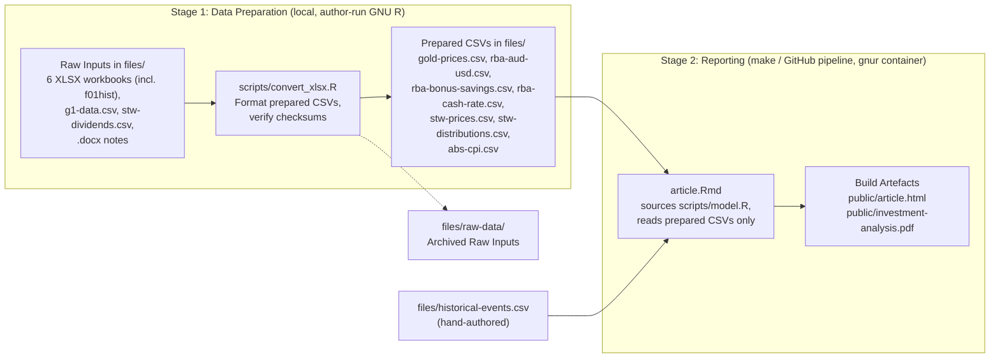

# Investment Analysis Requirements: Gold, Fixed Interest and Equities

This document specifies the data engineering, analytical methodology,
historical annotation, Australian ownership comparison, and GNU R charting
requirements for [article.Rmd](../article.Rmd). Its purpose is to establish a
fair, transparent, and reproducible 20-year comparison of an initial
**AUD 1,000** investment across three asset classes in Australia: **Gold**,
**Fixed Interest**, and **Australian Equities** (`ASX:STW`).

> **Scope Boundary:** This specification defines the target architecture and
> acceptance criteria prior to implementation. **Stage 1** (data preparation)
> is a local, author-run GNU R step that converts raw files into prepared CSVs.
> **Stage 2** (reporting) is `article.Rmd`, rendered by Makefile targets and
> the GitHub pipeline, which reads only the prepared CSVs.

## 1. Objective, Scope and Fairness Principles

### REQ-001: Core Objective and Capital Baseline

The analysis shall compare the historical nominal and risk-adjusted growth of
an initial lump-sum investment of **AUD 1,000** across Gold, Fixed Interest, and
Australian Equities over the common 20-year window from **July 2006 to July
2026** (`2006-07` to `2026-07`, exactly **241** monthly observations). The start
and end dates are governed by the full overlap of the available `ASX:STW` price
series.

### REQ-002: Canonical Asset Vehicles and Fairness Invariants

To ensure a like-for-like comparison for an Australian retail investor, the
analysis shall enforce the following asset definitions and fairness invariants:

- **Gold (AUD Spot Benchmark & ETF MER Sensitivities):** Unhedged monthly spot
  gold price converted from USD per troy ounce to AUD per troy ounce using
  Reserve Bank of Australia (RBA) exchange rates (`FXRUSD`). Because gold pays
  no yield, total return equals AUD spot price appreciation. Gross AUD spot is
  the primary charted benchmark, paired with two net-of-MER **Gold ETF
  sensitivities** (`0.40%` p.a. matching `ASX:GOLD` over 2006–2026, and `0.15%`
  p.a. matching `ASX:PMGOLD`) quantified in the summary and after-tax tables.
  Practical ownership differences against physical bullion are evaluated in
  Section 6.
- **Fixed Interest (Australian Bonus Savings Benchmark):** Official RBA Table F4
  **Retail Bonus Savings Rate** series (`AUD 10,000` balance advertised rates
  assuming monthly bonus conditions are satisfied) from
  `Historical Retail Bonus Savings Rates (2002-2026).xlsx`. Applied via
  12-month **Annual Rollover** using the `2006` through `2025` annual rates
  across the 20 July-to-July terms. The ACCC Retail Deposits Inquiry caveat
  (headline rates assume bonus rules are met) is noted in Section 6, and RBA
  Table F1.1 (`f01hist.xlsx`, `FIRMMCRT`) is included as a secondary
  monthly-compounded cash-rate floor reference (`fixed_interest_cash`).
- **Australian Equities (`ASX:STW`):** State Street's SPDR S&P/ASX 200 Fund
  (`ASX:STW`), modelled on a **Total Return (Dividend Reinvestment Plan / DRP)**
  basis using actual historical cash distributions from
  `stw-distributions.csv`. Both **STW Total Return (Cash DRP)**
  and **STW Price-Only** (plotted as a dashed reference line) shall be shown so
  readers see why excluding dividends severely understates equity returns
  relative to compounding fixed interest.
- **Fairness Invariants:**
  1. **Single Currency:** All time series shall be valued in nominal **AUD**.
  2. **Identical Horizon:** Every primary curve and metric shall span
     `2006-07-01` to `2026-07-01` with zero cherry-picked start dates.
  3. **Reinvestment Parity:** Zero-yield Gold (price growth) shall be compared
     against compounded Fixed Interest and reinvested-distribution Equities
     (Cash DRP).
  4. **Transparent Boundary Disclosures:** Charts display nominal pre-tax AUD
     growth (gross of brokerage and personal tax), while product management
     fees, Australian tax (marginal rate, 50% CGT discount, franking credits),
     and inflation (ABS CPI) are quantified in a dedicated scenario table and
     structured comparison sections.

### REQ-003: Educational and General Advice Disclaimer

The published article in [article.Rmd](../article.Rmd) shall include a clear
notice stating that the analysis is general educational information based on
historical data and does not constitute personal financial, investment, or tax
advice under Australian law.

### Non-Goals

This study explicitly excludes AUD-hedged gold ETFs, Australian bond ETFs,
individual equities outside `ASX:STW`, automated live data scraping in CI,
and personal financial or tax advice.

## 2. Source Data Inventory and Acquisition Plan

### REQ-004: Existing Audited Files in `investment-analysis/files/`

Eight source data files (plus the companion notes document
`historical interest rates 2002-2026.docx`) currently exist in
`investment-analysis/files/`. Table 1 records the exact file structure, date
coverage, and observed parsing quirks that must be handled during extraction.

| File Name | Sheet / Format | Date Coverage | Rows | Units & Key Fields | Discovered Quirks & Traps |
| :--- | :--- | :--- | :--- | :--- | :--- |
| `gold-prices-1833-2026.xlsx` | `monthly-processed.csv` (XLSX) | `1833-01-01` to `2026-10-01` | 2,326 | `Date`, `Price` (USD/troy oz) | Rows 2–805 (`1833–1899`) store `Date` as text strings; row 806 (`1900-01-02`) onward uses Excel serial dates (`datetime`), causing mixed-type failures in naive `readxl` imports. |
| `rba-exhange-rates-1969-2009.xlsx` | `Data` (XLSX, plus `Notes `) | `1969-07-31` to `2009-12-31` | 486 | `FXRUSD` (`A$1=USD`), Col 3 | Filename spells `exhange` without `c`; 10 metadata header rows; row 11 contains `Series ID`; month-end business dates; `Notes ` sheet name has trailing space. |
| `rba-exhange-rates-2010-2026.xlsx` | `f11-data.csv` (XLSX) | `2010-01-29` to `2026-10-30` | 202 | `FXRUSD` (`A$1=USD`), Col 2 | Filename spells `exhange` without `c`; 10 metadata rows; row 11 contains `Series ID`; `FXRUSD` shifts from Col 3 (1969–2009) to Col 2 (2010–2026). |
| `Historical Retail Bonus Savings Rates (2002-2026).xlsx` | `Historical Rates` (XLSX) | `2002` to `2026` (YTD Oct) | 25 | `Year`, `Avg. Bonus Savings Rate (% p.a.)` (Cols A, C; decimal) | Title/source rows 1–2; blank row 3; header row 4; dual side-by-side tables separated by blank Col F (ignore Cols G–J snapshot); row 30 contains `'2002–2025 Historical Average'` summary (exclude); rates stored as decimals (`0.0403` = `4.03%`); spaces and parentheses in filename. |
| `stw-monthly-2006-2026.xlsx` | `STW Historical Data.csv` (XLSX) | `2026-07-01` to `2006-07-01` | 241 | `Date`, `Price` (AUD close) | Stored in **descending** date order; zero nulls; price-only series (`AUD 49.19` in `2006-07` to `AUD 80.22` in `2026-07`), excluding distributions. |
| `stw-dividends.csv` | UTF-8 CSV | `2026-09-29` to `2006-06-26` | 62 | `Ex_Dividend_Date`, `Payment_Date`, `Cash_Distribution_AUD`, `Franking_Pct`, `Gross_Distribution_AUD` | Stored in **descending** order; `%` suffix on `Franking_Pct` and `Trailing_Yield_Pct`; `"N/A"` strings in `Trailing_Yield_Pct`; cadence shifts from semi-annual to quarterly in 2016. |
| `g1-data.csv` | UTF-8 CSV (with BOM) | `30/06/1922` to `30/09/2026` | 421 | `GCPIAG` (Col 2; `Index, Sept 2025 = 100`) | UTF-8 BOM (`\xef\xbb\xbf`); 10 metadata rows; `Series ID` on row 11; Australian `DD/MM/YYYY` dates; future placeholder rows (`31/12/2026`–`30/06/2027`) with empty values; ~9,566 blank trailing lines. |
| `f01hist.xlsx` | `Data` (XLSX, plus `Notes`) | `1969-06-30` to `2026-10-31` | 689 | `FIRMMCRT` (Col 2; `%` p.a. monthly avg) | 10 metadata rows; `Series ID` on row 11; broken OOXML `<dimension ref="A1"/>` tag and dangling `xl/drawings/drawing1.xml` ref (must bypass strict drawing/dimension checks); ~9,300 blank trailing rows; pre-1990 `None` values; minor float noise (e.g. `7.250002`, round to 4 dp). |

Key empirical observations from the initial data audit:

- **Continuous Common Coverage:** Filtering `gold-prices-1833-2026.xlsx` and the
  merged RBA `FXRUSD` workbooks to `2006-01` through `2026-10` yields 250
  consecutive months with zero gaps. Intersecting with
  `stw-monthly-2006-2026.xlsx` produces **241** contiguous monthly points from
  `2006-07` to `2026-07` with zero missing months.
- **STW Dividend Window Entitlement:** Filtering `stw-dividends.csv` by
  `Ex_Dividend_Date` within `[2006-07-01, 2026-07-31]` yields exactly **60**
  eligible distributions (`2006-12-21` paying `2007-01-04` through `2026-06-29`
  paying `2026-07-13`). The `2006-06-26` distribution went ex-dividend before
  the July 2006 entry date and `2026-09-29` falls after July 2026; both shall be
  excluded.
- **Observation Timing:** `gold-prices-1833-2026.xlsx` (`1833-01-01` = `18.93`,
  integer USD values across 2006–2026) is the historical **monthly average**
  spot series. Retain it as a documented limitation and require `article.Rmd`
  to state each series' timing basis explicitly: Gold (monthly average), RBA
  `FXRUSD` (month-end), STW `Price` (monthly bar close, so July 2006 shows
  Open `50.00` / Close `49.19` with entry/exit at month-end), RBA `FIRMMCRT`
  (monthly average), Bonus Savings (calendar-year average), and ABS CPI
  (quarterly index).
- **Franking Verification:** `Gross_Distribution_AUD` in `stw-dividends.csv`
  matches `Cash_Distribution_AUD * (1 + Franking_Pct * 30 / 70)` at a 30%
  corporate rate to within `0.002`. Fourteen of 62 rows differ by more than
  `0.0006` because their franking percentages are rounded to whole numbers, so
  the check shall use a tolerance and never exact equality.
- **Bonus Savings Context:** `historical interest rates 2002-2026.docx`
  documents the identical RBA Table F4 bonus-savings series alongside the ACCC
  Retail Deposits Inquiry finding (~71% of bonus savers miss monthly
  conditions) and shall move to `files/raw-data/` with the raw `.xlsx`
  workbooks after Stage 1 extraction.
- **CPI Inflation Audit (`g1-data.csv`):** Quarterly `GCPIAG` runs from
  `30/06/2006` (`59.65`) to `30/06/2026` (`102.31`), yielding **81** quarterly
  observations with zero missing values across the window (`+71.52%` cumulative
  inflation, `2.73%` p.a. CAGR; `AUD 1,000` in June 2006 requires `AUD 1,715.17`
  in June 2026 to maintain purchasing power).
- **RBA Cash Rate Floor (`f01hist.xlsx`):** `FIRMMCRT` supplies **250** gap-free
  monthly observations from `2006-01` to `2026-10` (`2006-07` `5.75%` to
  `2026-07` `4.35%`). Monthly compounding yields **AUD 1,841.31** (`3.10%` p.a.
  CAGR), corroborating the Bonus Savings benchmark (`AUD 1,901.60`, `3.27%`
  p.a. CAGR).

### REQ-005: Dataset Completeness

All mandatory and secondary reference datasets (Gold, RBA F11 exchange rates,
Bonus Savings, RBA Table F1.1 Cash Rate Target `f01hist.xlsx`, `ASX:STW` prices
and distributions, and ABS/RBA Table G1 CPI `g1-data.csv`) are now present on
disk in `investment-analysis/files/`. Zero missing source files remain prior to
Stage 1 extraction.

### REQ-006: Source Attribution and Provenance

Every raw and acquired dataset shall have its publisher, table/series code,
retrieval date, and official URL documented in a data-provenance table in
[article.Rmd](../article.Rmd) and in script header comments.

## 3. Data Preparation Stage: Formatting and Archiving Raw Inputs

### REQ-007: Prepared CSV Extraction (Stage 1)

A dedicated GNU R extraction script (`scripts/convert_xlsx.R`) shall format
**all** raw inputs—each `.xlsx` workbook plus raw `stw-dividends.csv` and
`g1-data.csv`—into clean, ascending-date, strictly typed UTF-8 **prepared
CSVs** containing **only the columns required for this analysis**. Table 2
defines the exact conversion mapping.

| Source File(s) | Target CSV File | Retained Columns | Extraction & Normalisation Rules |
| :--- | :--- | :--- | :--- |
| `gold-prices-1833-2026.xlsx` | `files/gold-prices.csv` | `date`, `gold_usd` | Read `Date` as text/mixed safely; parse `YYYY-MM-DD`; filter `>= 2006-01-01`; sort ascending; round `gold_usd` to 4 decimal places. |
| `rba-exhange-rates-1969-2009.xlsx` + `rba-exhange-rates-2010-2026.xlsx` | `files/rba-aud-usd.csv` | `date`, `aud_usd` | Locate `FXRUSD` dynamically by `Series ID` on row 11 (never hard-coded column number); parse data rows from row 12; normalise month-end dates to `YYYY-MM-01`; filter `>= 2006-01-01`; bind rows and sort ascending. |
| `stw-monthly-2006-2026.xlsx` | `files/stw-prices.csv` | `date`, `stw_price_aud` | Read `Date` and `Price` only (drop `Open`, `High`, `Low`, `Vol.`, `Change %`); format `date` as `YYYY-MM-01`; sort ascending (`2006-07-01` to `2026-07-01`). |
| `stw-dividends.csv` | `files/stw-distributions.csv` | `ex_dividend_date`, `payment_date`, `cash_distribution_aud`, `franking_pct`, `gross_distribution_aud` | Strip `%` signs and divide by `100` into numeric proportions (`0`–`1`); drop `Trailing_Yield_Pct` (removing `"N/A"` strings); remove trailing blank lines; sort ascending by `ex_dividend_date`. |
| `Historical Retail Bonus Savings Rates (2002-2026).xlsx` | `files/rba-bonus-savings.csv` | `year`, `bonus_savings_rate_pct` | Read `Historical Rates` Cols A and C only (rows 5–29; drop row 30 summary mean and Cols G–J side table); filter `2006 <= year <= 2026` (21 rows); multiply decimal rate by `100` and round to 2 decimal places (`0.0403` -> `4.03`); sort ascending by `year`. |
| `g1-data.csv` | `files/abs-cpi.csv` | `date`, `cpi_index` | Read UTF-8 with BOM; locate `GCPIAG` dynamically by `Series ID` on row 11; skip 10 metadata rows; parse `DD/MM/YYYY` dates and normalise to `YYYY-MM-01`; drop blank trailing rows and `NA` forecast rows; filter `2006-06-01` to `2026-06-01` (81 quarterly rows); sort ascending. |
| `f01hist.xlsx` | `files/rba-cash-rate.csv` | `date`, `cash_rate_pct` | Read `Data` sheet bypassing broken `<dimension ref="A1"/>` and dangling drawing XML; locate `FIRMMCRT` dynamically by `Series ID` on row 11; skip 10 metadata rows; normalise month-end dates to `YYYY-MM-01`; filter `>= 2006-01-01` (250 rows); round to 4 decimal places; sort ascending. |

Formatting raw `stw-dividends.csv` and `g1-data.csv` alongside the `.xlsx`
workbooks guarantees that zero unformatted source files remain in the active
analysis pipeline. The annotation catalogue (REQ-014) is hand-authored as
`files/historical-events.csv`; it has no raw source and is not produced by
Stage 1.

### REQ-008: Pre-Archive Verification Gate

Before any raw source file is archived, `scripts/convert_xlsx.R` shall execute
automated reconciliation assertions against the newly formatted CSVs:

1. **Row Count Parity:** `gold-prices.csv`, `rba-aud-usd.csv`, and
   `rba-cash-rate.csv` each contain at least 250 monthly rows from `2006-01-01`
   onward; `stw-prices.csv` contains exactly 241 rows from `2006-07-01` to
   `2026-07-01`; `rba-bonus-savings.csv` contains exactly **21** annual rows
   (`2006` through `2026`); `stw-distributions.csv` contains **62** ascending
   rows total (of which **60** fall within `ex_dividend_date`
   `[2006-07-01, 2026-07-31]`); `abs-cpi.csv` contains exactly **81** quarterly
   rows (`2006-06-01` through `2026-06-01`).
2. **No Missing Keys or Nulls:** Zero `NA` values, numeric `franking_pct` in
   `[0, 1]`, `abs(gross - cash * (1 + franking_pct * 30 / 70)) <= 0.002` on
   every distribution row, and strictly ascending, unique ISO `Date` (or
   integer `year`) keys across all extracted CSVs.
3. **Spot-Check Checksums:** Exact value parity against the raw source files:
   - `2006-07-01`: `gold_usd == 634.00`, `aud_usd == 0.7658`,
     `stw_price_aud == 49.19`
   - `2026-02-01`: `gold_usd == 5020.00`, `aud_usd == 0.7126`,
     `stw_price_aud == 82.63`
   - `2026-07-01`: `gold_usd == 4073.00`, `aud_usd == 0.7030`,
     `stw_price_aud == 80.22`
   - `rba-bonus-savings.csv`: `year 2006 == 4.03`, `year 2011 == 5.11` (peak),
     `year 2021 == 0.35` (low), `year 2025 == 4.30`, `year 2026 == 4.80`.
   - `rba-cash-rate.csv`: `2006-07-01 == 5.75`, `2008-08-01 == 7.25`,
     `2011-08-01 == 4.75`, `2020-11-01 == 0.11`, `2026-07-01 == 4.35`.
   - `stw-distributions.csv` (`2026-06-29`): `cash_distribution_aud == 0.7963`,
     `franking_pct == 0.3539`, `gross_distribution_aud == 0.9171`.
   - `abs-cpi.csv`: `2006-06-01 == 59.65`, `2026-06-01 == 102.31`.

### REQ-009: Archiving Raw Data and Stage Boundaries

1. **Stage 1 Runs Locally:** `scripts/convert_xlsx.R` is an author-run step. It
   is not part of the shared hard-linked `Makefile` or the GitHub pipeline, and
   its R packages (for example `readxl`) need not exist in the CI container.
2. **Raw-Data Archiving and Re-Runs:** Once REQ-008 passes, move **all**
   original raw source files (all six `.xlsx` workbooks including
   `f01hist.xlsx`, `historical interest rates 2002-2026.docx`, raw
   `stw-dividends.csv`, and `g1-data.csv`) to
   `investment-analysis/files/raw-data/`. On a re-run the script shall read each
   input from `files/raw-data/` when it is present there, otherwise from
   `files/`, so re-running never fails because a raw file has already moved.
3. **Committed Artefacts:** The prepared CSVs, `files/historical-events.csv`,
   and `scripts/*.R` are committed to git, so a fresh checkout and the CI build
   render the article without running Stage 1. `files/raw-data/` is retained
   for provenance only.
4. **Stage 2 Is Reporting:** Stage 2 renders [article.Rmd](../article.Rmd) with
   `make` and `make pdf`, locally and in the GitHub pipeline
   (`ghcr.io/frankhjung/gnur:4.5.2`). [article.Rmd](../article.Rmd) sources
   `scripts/model.R`, reads only the prepared CSVs, and never reads `.xlsx`
   files or `files/raw-data/`.

```bash
cd investment-analysis
Rscript scripts/convert_xlsx.R  # Stage 1 (local): prepared CSVs, archive raw
make && make pdf                # Stage 2: render report from prepared CSVs
```

```text
investment-analysis/
├── article.Rmd              # Stage 2: sources scripts/model.R, reads CSVs
├── scripts/
│   ├── convert_xlsx.R       # Stage 1 (local): raw -> prepared CSVs
│   └── model.R              # Pure analysis functions sourced by article.Rmd
└── files/
    ├── raw-data/            # Archived raw .xlsx, .docx, g1-data.csv, etc.
    ├── historical-events.csv  # Hand-authored annotations
    └── *.csv                # Prepared CSVs written by Stage 1
```

## 4. Analytical Modelling and Data Contracts



### REQ-010: Mathematical Transformation Rules

`scripts/model.R` shall expose pure functions that take the prepared CSVs,
align all series onto canonical monthly `YYYY-MM-01` dates from `2006-07-01` to
`2026-07-01` (241 observations), and apply the following exact formulas:

1. **Gold (AUD Spot Benchmark & Gold ETF Net-of-MER Sensitivities):**
   - **Gross AUD Spot (`gold_aud`):** Convert USD price to AUD:
     `gold_aud_t = gold_usd_t / aud_usd_t`. Index to initial AUD 1,000:
     `V_t = 1000 * (gold_aud_t / gold_aud_0)`. Audited checkpoints: `2006-07`
     (`AUD 827.89/oz`, `V_0 = 1000.00`), `2026-02` peak (`AUD 7,044.63/oz`), and
     `2026-07` (`AUD 5,793.74/oz`, `V_240 = AUD 6,998.18`, `10.22%` p.a. CAGR).
   - **Gold ETF Net-of-MER Sensitivities:** Apply continuous annual MER drag at
     month `t` (`t = 0..240`, elapsed years `t / 12`) via
     `V_t_net = V_t_spot * (1 - MER)^(t / 12)`:
     - `gold_etf_015` (`MER = 0.0015`, `0.15%` p.a., matching `ASX:PMGOLD`):
       20-year retention factor `0.97042` (~2.96% cumulative fee drag); verified
       `2026-07` checkpoint `AUD 6,791.20` (`10.05%` p.a. CAGR).
     - `gold_etf_040` (`MER = 0.0040`, `0.40%` p.a., matching `ASX:GOLD` across
       2006–2026): 20-year retention factor `0.92297` (~7.70% cumulative fee
       drag); verified `2026-07` checkpoint `AUD 6,459.10` (`9.78%` p.a. CAGR).
2. **Fixed Interest (Annual 12-Month Rollover from Bonus Savings Rates):**
   - Primary series (`fixed_interest_bonus`): start with `V_0 = 1000.00` on
     `2006-07-01`. For each consecutive 12-month term `y = 2006..2025`
     (`2006-07` to `2007-07` through `2025-07` to `2026-07`), lock the annual
     rate `r_y` (`bonus_savings_rate_pct` for year `y` from
     `rba-bonus-savings.csv`, e.g. `4.03%` for `2006` through `4.30%` for
     `2025`).
   - At maturity 12 months later (each July), reinvest principal plus earned
     interest in full to compound: `V_{y+1} = V_y * (1 + r_y / 100)`. Verified
     `2026-07` checkpoint across the 20 annual rollovers: **`AUD 1,901.60`**
     (`3.27%` p.a. nominal CAGR).
   - For intermediate monthly chart points `m = 1..11` within term `y`, record
     accrued simple interest along the locked annual rate:
     `V_{y,m} = V_y * (1 + (r_y / 100) * (m / 12))`, which matches maturity
     compounding identically at `m = 12`.
   - Accept locking each calendar-year average `r_y` (`2006..2025`) for its
     July-to-July 12-month term (`AUD 1,901.60`) as a documented
     annual-average approximation, cross-checked against the exact monthly RBA
     Cash Rate floor (`AUD 1,841.31`); disclose this basis in `article.Rmd`.
     Retain `year == 2026` (`4.80%` YTD Oct) in `rba-bonus-savings.csv` for
     provenance.
   - Secondary reference series (`fixed_interest_cash`): monthly compounded RBA
     Table F1.1 `cash_rate_pct` from `files/rba-cash-rate.csv`
     (`V_t = V_{t-1} * (1 + cash_rate_{t-1} / 1200)`), with verified `2026-07`
     checkpoint **`AUD 1,841.31`** (`3.10%` p.a. CAGR).
3. **Australian Equities (`ASX:STW` Price-Only & Cash DRP):**
   - **Price-Only (`stw_price_only`):**
     `V_t = 1000 * (stw_price_t / stw_price_0)`. Audited checkpoints:
     `AUD 49.19` (`2006-07`, `V_0 = 1000.00`) to `AUD 80.22` (`2026-07`,
     `V_240 = AUD 1,630.82`, `2.48%` p.a. CAGR).
   - **Total Return Cash DRP (`stw_total_return`):** Start with initial units
     `U_0 = 1000 / stw_price_0` (`20.329335` units at `AUD 49.19`, allowing
     fractional units for theoretical index parity). Filter
     `stw-distributions.csv` to `ex_dividend_date` in
     `[2006-07-01, 2026-07-31]` (60 distributions), map each
     `cash_distribution_aud` `D_t` to `floor_date(payment_date, "month")`, and
     accumulate units cleanly without mutation:
     `U_t = U_{t-1} + (U_{t-1} * D_t) / stw_price_t`, `V_t = U_t * stw_price_t`.
   - **Whole-Unit DRP Sensitivity (`stw_total_return_whole_unit`):** Buy
     `floor(1000 / 49.19) = 20` whole units at `2006-07` (`AUD 983.80`) and
     hold the `AUD 16.20` remainder plus every subsequent cash distribution in
     a `0%`-interest cash ledger. Whenever `cash >= stw_price_t`, purchase
     `floor(cash / stw_price_t)` whole units and carry remaining cash forward,
     valuing total wealth each month as `V_t = units_t * stw_price_t +
     residual_cash_t` (so `V_0 = 1000.00`). Fractional DRP remains the
     primary charted series; the end-value gap is reported in `article.Rmd`.
   - **Franking Credits Boundary:** Pre-tax charts shall plot Cash DRP
     (`cash_distribution_aud`), while franking credit benefits
     (`gross_distribution_aud - cash_distribution_aud`) are applied explicitly
     in the Australian after-tax scenario model (REQ-017) to avoid
     double-counting.
4. **Return, Volatility, Drawdown and CPI Deflation Metrics:**
   - Monthly simple return: `ret_t = V_t / V_{t-1} - 1` (`NA` at `t = 0`).
   - Cumulative return (%): `cum_return_pct = (V_t / 1000 - 1) * 100`.
   - Running drawdown (%): `drawdown_pct = (V_t / cummax(V_t) - 1) * 100`.
   - 20-year CAGR (%): `((V_240 / 1000)^(1 / 20) - 1) * 100`.
   - Annualised volatility (%): `sd(ret_t, na.rm = TRUE) * sqrt(12) * 100`.
   - Maximum drawdown (%): `min(drawdown_pct)`.
   - Real purchasing power (constant June 2006 AUD):
     `real_value_aud = nominal_value_aud / (cpi_2026_06 / cpi_2006_06)` where
     `cpi_2006_06 = 59.65` (`30/06/2006`) and `cpi_2026_06 = 102.31`
     (`30/06/2026`), giving an exact uninterpolated ratio of `1.71517` (so
     `AUD 1,715.17` nominal matches `AUD 1,000`). `article.Rmd` shall state
     this June-quarter CPI basis explicitly.

### REQ-011: In-Memory Data Contracts

The functions in `scripts/model.R` return the following data frames to
[article.Rmd](../article.Rmd). They are held in memory and are not written to
disk. [article.Rmd](../article.Rmd) reads only the prepared CSVs in `files/`
and `files/historical-events.csv`.

1. **`asset_performance_monthly`** (tidy long format for `ggplot2`,
   `241 * N_series` rows):
   - Columns: `date` (`YYYY-MM-DD`), `asset_class` (`Gold`, `Fixed Interest`,
     `Australian Equities`), `series_variant` (`gold_aud`, `gold_etf_015`,
     `gold_etf_040`, `fixed_interest_bonus`, `fixed_interest_cash`,
     `stw_total_return`, `stw_total_return_whole_unit`, `stw_price_only`),
     `value_aud` (numeric), `monthly_return` (numeric), `cum_return_pct`
     (numeric), `drawdown_pct` (numeric, `<= 0`).
2. **`asset_performance_wide`** (wide audit table, 241 rows):
   - Columns: `date`, `gold_usd`, `aud_usd`, `gold_aud`,
     `bonus_savings_rate_pct`, `cash_rate_pct`, `stw_price_aud`,
     `stw_cash_dist_aud`, `stw_franking_pct`, `gold_value_aud`,
     `gold_etf_015_value_aud`, `gold_etf_040_value_aud`,
     `fixed_interest_value_aud`, `cash_value_aud`, `stw_tr_value_aud`,
     `stw_price_value_aud`.
3. **`historical_events`** (read from `files/historical-events.csv`):
   - Columns: `event_id`, `date`, `end_date`, `label`, `short_label`,
     `primary_asset`, `impact_direction`, `summary`, `chart_priority` (`1` for
     combined hero charts, `2` for asset-specific faceted charts).
4. **`summary_metrics`** (headline and tax/CPI scenarios):
   - Columns: `asset_class`, `series_variant`, `end_value_nominal_aud`,
     `total_return_pct`, `cagr_pct`, `annual_volatility_pct`,
     `max_drawdown_pct`, `end_value_real_aud`, `after_tax_32_nominal_aud`,
     `after_tax_32_real_aud`, `after_tax_39_nominal_aud`,
     `after_tax_39_real_aud`.

### REQ-012: Automated Data Integrity Assertions

`scripts/model.R` shall provide validation functions that
[article.Rmd](../article.Rmd) calls before charting. Each shall fail the render
immediately via `stop()` if any of the following invariants fail:

- Every `series_variant` has exactly **241** rows covering `2006-07-01` through
  `2026-07-01` with strictly ascending unique dates.
- Zero `NA` values in `value_aud`, `cum_return_pct`, or `drawdown_pct`.
- Every series starts at exactly `1000.00` on `2006-07-01`.
- All prices, FX rates, and unit counts are strictly positive (`> 0`).
- `gold_aud >= gold_etf_015 >= gold_etf_040` for every month `t >= 0`.
- `stw_total_return >= stw_price_only` for every month `t >= 0`.

### REQ-013: GNU R Code Quality Standards

All R scripts (`scripts/convert_xlsx.R`, `scripts/model.R`) and R Markdown
chunks in [article.Rmd](../article.Rmd) shall adhere to `gnur-programmer`
standards:

- Tidyverse style with `snake_case` identifiers, 2-space indentation, native
  pipe `|>`, and comments hard-wrapped at 80 columns.
- Pure, deterministic helper functions avoiding explicit `for`/`while` loops
  where vectorisation or `purrr::accumulate()` / `Reduce()` applies.
- Unit tests for every `scripts/model.R` function in `tests/testthat/`, run
  locally, asserting the REQ-010 checkpoints (`AUD 6,998.18`, `AUD 6,791.20`,
  `AUD 6,459.10`, `AUD 1,901.60`, `AUD 1,841.31`, `AUD 1,630.82`, and the
  CPI ratio `1.71517`).
- Static verification passing `lintr::lint()` cleanly without syntax or style
  warnings.

## 5. Historical Event Annotations

### REQ-014: Curated 2006–2026 Macroeconomic Event Catalogue

Table 3 specifies the mandatory historical annotations explaining drivers and
cross-asset interactions (highlighting how AUD/USD shifts amplify or dampen
AUD gold returns relative to USD prices).

| Event ID | Window | Priority | Short Chart Label | Primary Impact Across Assets |
| :--- | :--- | :--- | :--- | :--- |
| `EVT-01` | `2007-11` to `2009-02` | Tier 1 | GFC & RBA Cuts | STW falls steeply (`AUD 31.40` in `2009-02`); RBA cuts cash rate `7.25%` to `3.00%`; falling AUD (`0.6454`) amplifies AUD Gold surge (`AUD 1,461/oz`). |
| `EVT-02` | `2010-10` to `2011-08` | Tier 1 | AUD Parity Caps Gold | USD Gold hits crisis highs (`USD 1,759/oz`), but `AUD/USD > 1.05` (`1.0691`) caps AUD Gold (`AUD 1,645/oz`); RBA hikes to `4.75%` lift deposits. |
| `EVT-03` | `2013-04` to `2015-12` | Tier 2 | Gold Bear & RBA Easing | USD Gold drops ~40% (`USD 1,076/oz`), cushioned locally by falling AUD (`0.7306`); RBA easing pulls retail bonus savings rates from `4.27%` to `2.88%`. |
| `EVT-04` | `2020-03` to `2020-11` | Tier 1 | COVID-19 & Ultra-Low Rates | Sharp STW shock (`AUD 47.99`) and stimulus rebound; RBA cuts push bonus savings to a `0.35%` trough (`2021`); AUD Gold climbs past `AUD 2,677/oz`. |
| `EVT-05` | `2022-05` to `2023-11` | Tier 1 | Inflation & Rate Hikes | Fastest RBA tightening cycle in decades lifts bonus savings rates from `0.35%` (`2021`) to `4.45%–4.87%` (`2023–2024`) while weighing on equities; resource dividends peak (`AUD 1.9401` STW payout Jun 2022). |
| `EVT-06` | `2024-03` to `2026-07` | Tier 1 | Gold Record & Pullback | Central-bank demand drives AUD Gold past `AUD 7,044/oz` (`2026-02`) before cooling to `AUD 5,794/oz` (`2026-07`); STW clears `AUD 80`. |
| `EVT-07` | `2016-06` | Tier 2 | STW Quarterly DRP | STW transitions from semi-annual (`Jun/Dec`) to quarterly (`Mar/Jun/Sep/Dec`) distributions, increasing cash-flow frequency. |

### REQ-015: Annotation Placement and Clutter Limits

- Combined multi-asset charts (Charts 1 and 2) shall display **only Tier-1
  events** (at most 5–6 callouts) using vertical dashed date markers or subtle
  shaded regime bands and non-overlapping text labels.
- Tier-2 asset-specific annotations (`EVT-03`, `EVT-07`, and AUD/USD currency
  commentary) shall appear on the faceted per-asset panels (Chart 3) and in the
  supporting narrative.

## 6. Asset Class Pros and Cons Framework

[article.Rmd](../article.Rmd) shall include a structured pros-and-cons matrix
and supporting prose examining ownership in Australia across three dimensions.

### REQ-016: Management Fees and Transaction Costs

- **Gold:** Contrast physical bullion (`0%` ongoing MER if self-stored, offset
  by 2%–6% retail dealer buy/sell spreads and optional vaulting/insurance fees
  of ~0.5%–1.0% p.a.) against ASX-listed Gold ETFs (`ASX:PMGOLD` `0.15%` p.a.
  in `gold_etf_015`, `ASX:GOLD` `0.40%` p.a. in `gold_etf_040`, plus ASX
  brokerage and tight on-market spreads). Quantify the 20-year cumulative MER
  drag (~2.96% for `0.15%` p.a. and ~7.70% for `0.40%` p.a.).
- **Fixed Interest:** Retail bonus savings accounts and term deposits carry
  `0.00%` explicit management fee and zero brokerage, but embed the bank's net
  interest margin and impose strict monthly bonus conditions (minimum deposits
  and zero withdrawals) or term break penalties. Contrast briefly with
  Australian composite bond ETFs (typically ~0.10%–0.15% p.a. MER).
- **Australian Equities (`ASX:STW`):** Document STW's multi-decade fee
  compression (State Street Global Advisors, `ssga.com`: currently `0.05%`
  p.a., reduced historically from `0.286%` and `0.13%`), plus one-off ASX
  brokerage and narrow bid-ask spreads; zero ongoing platform fee on
  CHESS-sponsored holdings. Note that historical STW market prices already
  reflect MER deduction inside the fund's Net Asset Value.

### REQ-017: Australian Tax Implications and After-Tax Scenario Table

1. **Asset-Specific ATO Tax Rules:**
   - **Gold:** Produces no annual assessable income (100% tax-deferred growth
     until disposal). Eligible for the **50% Capital Gains Tax (CGT) discount**
     for Australian resident individuals holding longer than 12 months.
     Investment-grade gold bullion (purity >= 99.5%) is **GST-exempt** under
     s 38-385 of the *A New Tax System (Goods and Services Tax) Act 1999*,
     unlike collectable or numismatic coins.
   - **Fixed Interest:** Interest is taxed annually as ordinary assessable
     income at the investor's full marginal tax rate plus 2% Medicare levy, with
     **zero CGT discount**. Annual taxation creates compounding tax drag and
     exposes savers to negative real after-tax returns when CPI exceeds
     post-tax interest rates.
   - **Australian Equities (`ASX:STW`):** Distributions are taxed annually in
     the year of entitlement (including distributions reinvested via DRP),
     offset by **franking credits** under Australia's dividend imputation
     system (historically ~45%–90% franked in `stw-distributions.csv`, with
     excess credits refundable to eligible resident taxpayers). Attribution
     Managed Investment Trust (AMIT) cost-base adjustments alter CGT cost bases
     annually, while capital gains realised after > 12 months receive the
     **50% CGT discount**.
2. **After-Tax & CPI Scenario Table Requirement:**
   `scripts/model.R` shall compute and `article.Rmd` shall display a
   scenario table covering `gold_aud`, `gold_etf_015`, `gold_etf_040`,
   `fixed_interest_bonus`, and `stw_total_return` for an Australian resident
   individual at two representative marginal brackets (**32%** = 30% marginal
   + 2% Medicare levy; **39%** = 37% marginal + 2% Medicare levy) showing:
   - **Fixed Interest Annual Tax:** Deduct tax at each of the 20 annual July
     maturities (`2007-07` through `2026-07`) at the marginal+Medicare rate
     (`32%` or `39%`) before rolling over the net balance into the next
     12-month term.
   - **STW Distribution Tax (AMIT Attribution):** Attribute each STW
     distribution to the Australian financial year (`1 Jul – 30 Jun`) of its
     `ex_dividend_date` (matching AMIT rules for June distributions paid in
     July), apply franking credit offsets (`gross_distribution_aud -
     cash_distribution_aud`), deduct net tax (or add excess franking credit
     refunds), and reinvest only the net after-tax distribution.
   - **Parcel-Level CGT at Liquidation (`2026-07`):** Track each STW DRP
     parcel's acquisition date and cost base in `scripts/model.R`; apply
     the **50% CGT discount** only to parcels held `> 12` months (acquired
     before `2025-07-01`) and tax gains on parcels held `<= 12` months
     (`>= 2025-07-01`) at the full marginal+Medicare rate. Gold (single
     parcel held 20 years) receives the 50% CGT discount at liquidation.
   - Nominal Pre-Tax Ending Value (AUD)
   - Real Pre-Tax Value (constant June 2006 AUD via ABS CPI, where
     `AUD 1,715.17` nominal equals `AUD 1,000` initial purchasing power)
   - Nominal After-Tax Value (full liquidation at `2026-07` under the rules
     above)
   - Real After-Tax Value (constant June 2006 AUD via ABS CPI)
   - **Explicit Caveat:** State clearly that the table models a constant
     marginal tax bracket across 20 years and ignores personal brokerage,
     AMIT cost-base micro-adjustments, and stage-3/historical tax-scale shifts.

### REQ-018: Ease of Management and Compounding Mechanics

- **Gold:** Minimal annual tax paperwork when held outright and automatic
  tax-deferred compounding of price changes, but generates **zero cash flow**
  to compound further. Physical bars incur storage, security, insurance, and
  assay liquidity friction; ASX Gold ETFs remove custody friction via standard
  CHESS brokerage.
- **Fixed Interest:** Maximum capital stability, zero price volatility, and
  Australian Government Financial Claims Scheme (FCS) protection up to
  **AUD 250,000** per account holder per Authorised Deposit-taking Institution
  (ADI). Trade-offs include **bonus-condition forfeiture risk** (as highlighted
  by the ACCC Retail Deposits Inquiry, ~71% of bonus savings accounts fail to
  meet monthly deposit or withdrawal conditions in a given month and revert to
  a much lower base rate), reinvestment/rate-change risk, and manual
  rate-shopping ("honeymoon rate" decay).
- **Australian Equities (`ASX:STW`):** Single-trade diversification across 200
  ASX companies, high T+1/T+2 liquidity, and automated DRP compounding. Two
  practical caveats shall be emphasised explicitly for small balances:
  1. **Whole-Unit DRP Friction on AUD 1,000:** Theoretical DRP modelling assumes
     fractional unit reinvestment, whereas ASX DRP plans allot **whole units
     only**. On ~20 units of STW, a quarterly distribution of AUD 10–20 is below
     one unit price (AUD 50–80), leaving cash residuals sitting uninvested in a
     DRP carry-forward balance across several quarters before buying one unit.
  2. **Tax Administration:** Requires annual AMIT tax-statement entry and
     per-parcel CGT cost-base tracking across up to 60 DRP parcels over 20
     years.

## 7. GNU R Charting and Visualisation Specification

### REQ-019: Required Charts in `article.Rmd` (2006–2026)

[article.Rmd](../article.Rmd) sources `scripts/model.R`, reads only the
prepared CSVs and `files/historical-events.csv`, performs zero raw-data parsing
or Excel and `files/raw-data/` reads, and renders four publication-quality
`ggplot2` charts from the `scripts/model.R` data frames:

1. **Chart 1 — Growth of AUD 1,000 (Linear Scale, Hero Chart):** Multi-line
   time series (`2006-07` to `2026-07`) showing `gold_aud`,
   `fixed_interest_bonus`, `stw_total_return`, and dashed `stw_price_only`, with
   Tier-1 historical event markers and direct end-of-line AUD value labels.
2. **Chart 2 — Growth of AUD 1,000 (Log10 Scale):** Identical trajectories on a
   base-10 logarithmic Y-axis (`scale_y_log10`) so equal vertical distances
   represent equal percentage gains, preventing Gold's 2024–2026 rally from
   compressing 2006–2019 comparison patterns.
3. **Chart 3 — Asset Class Small Multiples:** Three-panel faceted view
   (`facet_wrap(~ asset_class, ncol = 1)` or responsive grid) showing each asset
   individually with Tier-2 asset-specific annotations (including USD vs AUD
   Gold divergence during `2010–2011` AUD parity, Gold ETF net-of-MER
   comparison band `gold_etf_015`/`gold_etf_040`, and RBA rate regimes).
4. **Chart 4 — Downside Risk and Drawdown Profile:** Peak-to-trough underwater
   drawdown trajectories (`drawdown_pct`, `2006-07` to `2026-07`) accompanied by
   a summary risk-return table (CAGR, annualised volatility, maximum drawdown).

### REQ-020: Visual Design and Dual HTML/PDF Accessibility

- **Palette Harmonised with `files/article.css` (`--accent: #1771ad`):**
  - `Australian Equities (STW Total Return)`: `#1771ad` (solid, size `0.95`)
  - `Australian Equities (STW Price-Only)`: `#7f8c8d` (dashed line, size `0.7`)
  - `Gold (AUD Spot)`: `#c88a00` (solid line, size `0.95`)
  - `Fixed Interest (Bonus Savings, Annual Rollover)`: `#2e7d6b` (solid line,
    size `0.95`; secondary Cash Rate floor `fixed_interest_cash` as dotted
    `#2e7d6b`)
- **Monochrome Print Readability:** Combine distinct linetypes and direct
  end-of-series labels so charts remain legible under greyscale `@media print`
  styles in [article.css](article.css) and LaTeX PDF output.
- **Typography & Framing:** Minimalist `theme_minimal()` base with horizontal
  gridlines only, explicit AUD formatting (`scales::label_dollar`), `300` DPI
  output, `fig.width = 9`, `fig.height = 5.5` for combined charts, clear titles,
  descriptive subtitles specifying period and nominal pre-tax AUD basis, and
  concise source captions.

### REQ-021: Container Build Environment Compatibility

Before implementing `scripts/model.R` and chart chunks, inspect installed R
packages inside
`ghcr.io/frankhjung/gnur:4.5.2` (used by `.github/workflows/publish.yml`).
Prefer standard packages (`ggplot2`, `dplyr`, `tidyr`, `readr`, `scales`,
`knitr`). Provide clean `ggplot2::annotate()` label placement so charts build
deterministically without relying on optional packages (`ggrepel`, `patchwork`)
unless confirmed present in the image.

## 8. Article Structure and Editorial Standards

### REQ-022: `article.Rmd` Layout and Style Compliance

[article.Rmd](../article.Rmd) shall satisfy repository `blog-editor`,
`markdown-editor`, and `gnur-programmer` mandates:

- **Front Matter & Banner:** Valid YAML front matter (`title` in Title Case,
  `author: "[Frank Jung](https://www.linkedin.com/in/frankjung/)"`, dynamic R
  `date`, lowercase `tags` array), followed immediately by a 16:9 banner image
  (``).
- **Inverted Pyramid Narrative Flow:**
  1. Hook, nut graph, headline AUD 1,000 comparison table, and disclaimer.
  2. Methodology and fairness rules (AUD FX conversion, Fixed Interest
     compounding, STW Cash DRP vs Price-Only).
  3. 2006–2026 Performance Charts (Linear, Log10, Small Multiples, Drawdown)
     and historical event walkthrough.
  4. Pros and Cons in Australia (Fees, ATO Tax & After-Tax/CPI Scenario Table,
     Ease of Management & Whole-Unit DRP Mechanics).
  5. Practical Takeaways and Source Provenance Appendix.
- **Prose & Build Compliance:** Australian English throughout, 80-column
  hard-wrapped Markdown prose, presentation R chunks configured with
  `echo = FALSE, message = FALSE, warning = FALSE` reading only prepared
  CSVs, and clean compilation via both `make`
  (`public/article.html`) and `make pdf` (`public/investment-analysis.pdf`).

## 9. Acceptance Criteria and Verification Checklist

### REQ-023: Stage 1 Data Preparation Gate (Local)

- [x] Acquire all mandatory and reference raw datasets in
      `investment-analysis/files/` (six `.xlsx` workbooks including
      `f01hist.xlsx`, plus `g1-data.csv` and `stw-dividends.csv`).
- [ ] Run `Rscript scripts/convert_xlsx.R` locally with its R packages
      installed, producing all prepared CSVs (including
      `files/rba-cash-rate.csv`, `files/stw-distributions.csv`, and
      `files/abs-cpi.csv`) in `investment-analysis/files/`.
- [ ] Pass all REQ-008 spot-check checksums and row-count assertions before
      archiving all raw inputs (`.xlsx` workbooks,
      `historical interest rates 2002-2026.docx`, `g1-data.csv`, and raw
      `stw-dividends.csv`) into `investment-analysis/files/raw-data/`.
- [ ] Author `files/historical-events.csv` from REQ-014.
- [ ] Commit the prepared CSVs, `files/historical-events.csv`, and
      `scripts/*.R` so CI renders without running Stage 1.
- [ ] Pass `lintr::lint()` and the `tests/testthat/` suite for all scripts.

### REQ-024: Stage 2 Reporting and Editorial Gate

- [ ] Confirm required R packages for `article.Rmd` and `scripts/model.R` in
      `ghcr.io/frankhjung/gnur:4.5.2`.
- [ ] Verify [article.Rmd](../article.Rmd) reads only prepared CSVs, with zero
      runtime calls to `.xlsx` or `files/raw-data/`, and that all REQ-012
      assertions pass during the render.
- [ ] Render `make` (`public/article.html`) and `make pdf`
      (`public/investment-analysis.pdf`) cleanly without warnings or errors,
      then confirm the GitHub publish pipeline builds the same HTML.
- [ ] Visually inspect all four charts in rendered HTML and PDF to confirm zero
      overlapping labels, crisp typography, and accurate event placement.
- [ ] Confirm Australian English spelling, 80-column prose wrapping, valid YAML
      front matter, complete source citations, and general-advice disclaimer.
