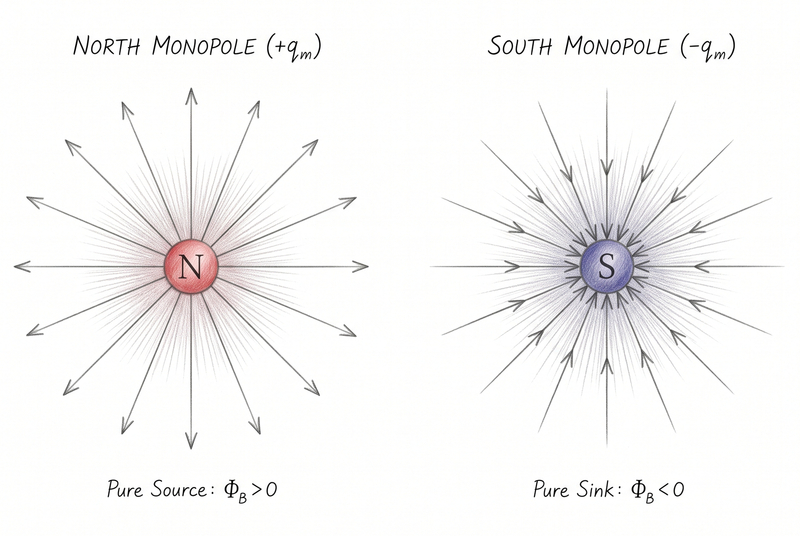

If you have ever played with fridge magnets, you know the golden rule of
magnetism: every magnet has a north pole and a south pole. Push two north poles
together and they resist you. Flip one around and they snap together. It is a
simple, familiar fact: magnetic poles always come in pairs.

That leads to a natural question. If I cut a bar magnet in half, do I get one
piece that is purely north and another that is purely south? In the workshop,
the answer is no. Nature never hands you an isolated pole. Instead, you get two
smaller magnets, each complete with its own north and south pole. Cut again, and
you get four. Keep slicing down to the single atom, and you still end up with a
two-poled magnet—a dipole—never a solitary pole.

So imagine my surprise when I first heard about magnetic monopoles: hypothetical
particles carrying only a single magnetic pole. For nearly a century, physicists
have hunted for this rebel particle—an elementary charge that is pure north or
pure south. Finding one would do far more than settle a bet. It would solve one
of the deepest puzzles in physics: why electricity and magnetism, otherwise so
alike, play by different rules.

## The Great Asymmetry: Electricity vs Magnetism

To understand why physicists care so much about magnetic monopoles, we have to
look at magnetism's twin sibling: electricity.

Electricity and magnetism are two sides of the same coin: electromagnetism. Yet
when you look at how their charges behave, there is a glaring asymmetry:

- **Electric charges exist as monopoles:** You can isolate a single positive
  charge, like a proton, or a single negative charge, like an electron.
- **Magnetic charges only appear as dipoles:** Every magnet ever observed in
  free space carries both a north and a south pole.

In classical physics, this rule is written into one of the foundation stones of
electromagnetism: [Gauss's law for magnetism][gauss-law], one of the four famous
equations of [James Clerk Maxwell][maxwell]'s electromagnetic theory:

$$\nabla \cdot \mathbf{B} = 0$$

In plain English, this equation states that magnetic field lines never begin or
end. Unlike electric field lines, which radiate outward from positive charges
and terminate on negative charges, magnetic field lines always form continuous,
closed loops.

## Visualising the Difference: Dipole vs Monopole Fields

You can see what this equation means in practice by comparing the field of an
ordinary bar magnet with that of a monopole.

### 1. The Normal Magnet (Magnetic Dipole)

Because a normal magnet has no isolated magnetic charge acting as a starting
point, its field lines emerge from the north pole, curve through space to the
south pole, and continue through the magnet itself to complete the loop. If you
draw an imaginary closed surface anywhere around—or even partially through—the
magnet, every field line that enters must also leave. The net magnetic flux,
$\Phi_B$, is always zero.

### 2. The Hypothetical Magnetic Monopole

If a magnetic monopole existed, its magnetic field would look just like the
electric field of a single proton or electron. The field lines would radiate
straight out into space for a north monopole, or point straight inward from all
directions for a south monopole:

$$\mathbf{B} \propto \frac{q_m}{r^2}\hat{\mathbf{r}}$$

Finding even one of these particles would make Maxwell's equations beautifully
symmetrical. A magnetic charge density, $\rho_m$, would replace that lonely
zero in $\nabla \cdot \mathbf{B} = 0$.

## Why Do Physicists Think They Exist?

If we have never seen a fundamental magnetic monopole, why do so many physicists
suspect nature makes them anyway? There are two powerful theoretical reasons.

### 1. Paul Dirac's 1931 Breakthrough

In 1931, the quantum pioneer [Paul Dirac][dirac] asked a deceptively simple
question: what would happen to quantum mechanics if a magnetic monopole existed?
His mathematical answer stunned the physics community.

Dirac proved mathematically that if even a single magnetic monopole existed
anywhere in the cosmos, it would force all electric charges in the universe to
come in discrete, quantised packets. In other words, electric charge could not
take arbitrary values; it would have to come in multiples of a fundamental unit.

That is precisely what we observe. Every free electron has a charge of $-1e$,
and every proton has a charge of $+1e$ (built from confined quarks with exact
thirds of $e$). Nothing carries an arbitrary charge like $0.374e$. Without
monopoles, classical physics had no baseline explanation for why charge is
quantised. With a monopole, quantisation follows as a mathematical certainty.

As Dirac famously remarked, he would be surprised if nature had made no use of
this mechanism.

### 2. Grand Unified Theories (GUTs)

Physicists later found an even stronger reason. In Grand Unified Theories, which
merge the strong, weak, and electromagnetic forces at the extreme temperatures
of the early universe, monopoles are not merely allowed—they are required.

As the newborn universe cooled and shifted phases, knots in the fabric of the
unified field should have frozen into place. Physicists call these knots
topological defects, and each one would form an ultra-heavy magnetic monopole.
These GUT monopoles would weigh roughly $10^{16}$ times the mass of a proton,
or about the mass of a single bacterium packed into a subatomic point.

Why, then, is the universe not teeming with them? This puzzle—the *Monopole
Problem*—helped inspire the theory of cosmic inflation, which proposes that an
early burst of exponential expansion diluted these primordial relics across vast
cosmic distances. And because GUT monopoles are so massive, they are far too
heavy to forge inside human-made accelerators like the Large Hadron Collider.

## Have We Found One Yet?

To date, no fundamental magnetic monopole has ever been confirmed in free space.
Still, the experimental trail features one famous cliffhanger and a remarkable
breakthrough in solid-state physics.

### The Valentine's Day Monopole (1982)

On 14 February 1982, physicist Blas Cabrera at Stanford University checked a
superconducting loop detector he had built in his lab. When an ordinary magnetic
dipole passes through a superconducting ring, the current jumps up and then
drops back to zero. A monopole, however, leaves a permanent, quantised step in
current.

That afternoon, Cabrera's detector recorded a permanent jump of eight quantum
units of magnetic flux—the exact fingerprint of a single Dirac monopole. The
physics world went wild.

Then it never happened again. Years of larger, more sensitive follow-up
detectors failed to replicate the signal. Today, the "Valentine's Day Monopole"
remains one of the great cold cases in experimental science.

### Simulated Monopoles in Spin Ice

While the hunt for cosmic monopoles continues, condensed-matter physicists have
created the next best thing inside exotic crystals known as spin ices.

Inside a spin ice cooled near absolute zero, magnetic atoms sit at the corners
of tiny, three-dimensional pyramids. When physicists inject energy to flip a
chain of these atomic magnets, the north pole at one end of the chain and the
south pole at the other untether. They hop independently from atom to atom
through the crystal.

These loose ends are not true elementary particles in free space, but collective
ripples—or *quasiparticles*—that obey the exact same mathematical laws as
magnetic monopoles. They give physicists a laboratory playground to test how
monopoles behave firsthand.

Meanwhile, the search for fundamental monopoles presses on across two fronts:
cosmic observatories like [IceCube][icecube] in Antarctica watch for ancient,
ultra-heavy GUT relics from the Big Bang, while collider experiments like
[MoEDAL][moedal] at CERN hunt for lighter monopoles that could be forged in
high-energy particle collisions.

## The Takeaway

Next time you stick a note to your fridge, take a moment to appreciate how
strange that little magnet really is. Every magnet you have ever touched is a
closed loop of force, hiding a symmetry that physicists have spent nearly a
century trying to unlock.

Somewhere out there, left over from the dawn of time, a solitary magnetic pole
might still be drifting through the cosmos, waiting to complete the laws of
physics.

[dirac]: https://en.wikipedia.org/wiki/Paul_Dirac
[gauss-law]: https://en.wikipedia.org/wiki/Gauss%27s_law_for_magnetism
[icecube]: https://icecube.wisc.edu/
[maxwell]: https://en.wikipedia.org/wiki/James_Clerk_Maxwell
[moedal]: https://home.cern/science/experiments/moedal
