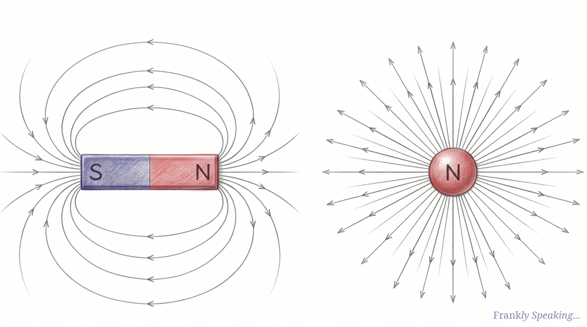
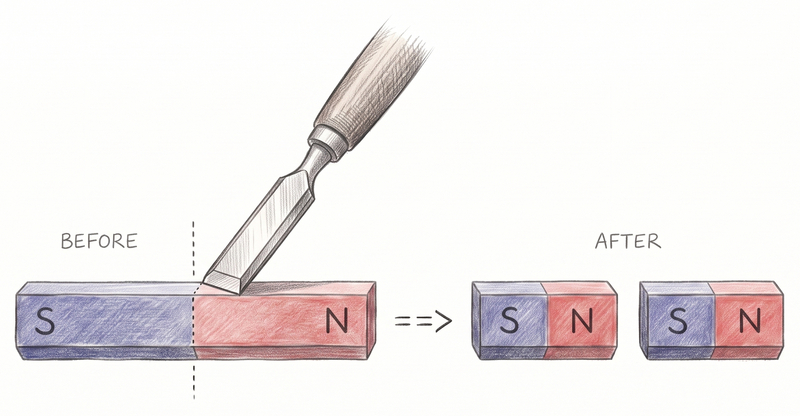
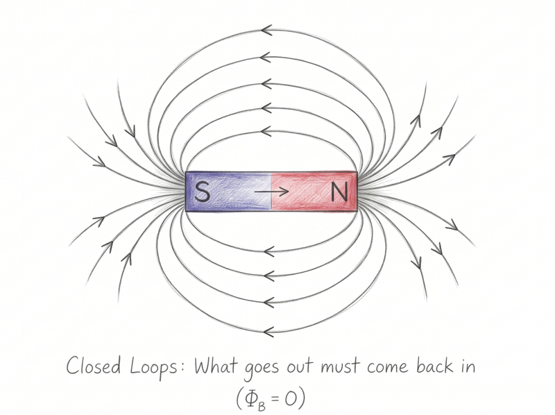

Cut a bar magnet in half. Do you get one piece that is purely north and another
that is purely south? In the workshop, the answer is no. Nature never hands you
an isolated pole. You get two smaller magnets, each with its own north and
south. Keep slicing down to a single atom and you still have a dipole, never a
lone pole.

Physicists have hunted for the exception for nearly a century: the magnetic
monopole, a hypothetical particle carrying a single magnetic pole. Finding one
would do far more than settle a bet. It would restore a missing symmetry in the
laws of electromagnetism. This article explains why physicists expect monopoles
to exist, why one famous sighting still haunts the field, and where the search
stands today.

## The Great Asymmetry: Electricity vs Magnetism

Magnetic monopoles matter because of magnetism's twin: electricity.

Electricity and magnetism are two sides of the same coin: electromagnetism. Yet
their charges behave very differently:

- **Electric charges exist as monopoles:** You can isolate a single positive
  charge, like a proton, or a single negative charge, like an electron.
- **Magnetic charges only appear as dipoles:** Every magnet ever observed
  carries both a north and a south pole.

Classical physics writes this rule into [Gauss's law for magnetism][gauss-law],
one of the four famous equations of [James Clerk Maxwell][maxwell]'s
electromagnetic theory:

$$\nabla \cdot \mathbf{B} = 0$$

In plain English: magnetic field lines never begin or end. Electric field lines
radiate outward from positive charges and terminate on negative charges.
Magnetic field lines always form continuous, closed loops.

## Visualising the Difference: Dipole vs Monopole Fields

Compare the field of an ordinary bar magnet with that of a monopole to see what
the equation means in practice.

### The Normal Magnet (Magnetic Dipole)

A normal magnet has no isolated magnetic charge to act as a starting point. Its
field lines emerge from the north pole, curve through space to the south pole,
and continue through the magnet itself to complete the loop.

Draw an imaginary closed surface anywhere around the magnet, or even partially
through it, and every field line that enters must also leave. The net magnetic
flux, $\Phi_B$, is always zero.

### The Hypothetical Magnetic Monopole

If a magnetic monopole existed, its magnetic field would look just like the
electric field of a single proton or electron. The field lines would radiate
straight out into space for a north monopole, or point straight inward from all
directions for a south monopole:

$$\mathbf{B} \propto \frac{q_m}{r^2}\hat{\mathbf{r}}$$

Finding even one of these particles would make Maxwell's equations beautifully
symmetrical. A magnetic charge density, $\rho_m$, would replace that lonely zero
in $\nabla \cdot \mathbf{B} = 0$.

## Why Do Physicists Think They Exist?

We have never seen a fundamental magnetic monopole, so why do so many
physicists suspect nature makes them anyway? There are two powerful theoretical
reasons.

### Paul Dirac's 1931 Insight

In 1931, the quantum pioneer [Paul Dirac][dirac] asked a deceptively simple
question: what would happen to quantum mechanics if a magnetic monopole
existed? His answer has shaped monopole searches ever since.

Dirac showed that if even a single magnetic monopole existed anywhere in the
cosmos, electric charge would have to come in discrete, quantised packets. It
could not take arbitrary values. It would have to come in multiples of a
fundamental unit.

That is precisely what we observe. Every free electron has a charge of $-1e$,
and every proton has a charge of $+1e$ (built from confined quarks carrying
exact thirds of $e$). Nothing free carries an arbitrary charge like $0.374e$.

Without monopoles, classical physics had no baseline explanation for why charge
is quantised. With a monopole, quantisation follows as a mathematical
certainty.

Dirac himself put it modestly in his 1931 paper: one would be surprised if
nature had made no use of this mechanism.

### Grand Unified Theories (GUTs)

Physicists later found an even stronger reason. Grand Unified Theories merge the
strong, weak, and electromagnetic forces at the extreme temperatures of the
early universe. In these theories, monopoles are not merely allowed – they are
predicted.

As the newborn universe cooled and shifted phases, knots in the fabric of the
unified field should have frozen into place. Physicists call these knots
topological defects, and each one would form an ultra-heavy magnetic monopole.
A GUT monopole would weigh roughly $10^{16}$ times the mass of a proton: tens of
nanograms, about the mass of a handful of living cells, packed into a
subatomic point.

Why, then, is the universe not teeming with them? This puzzle – the *Monopole
Problem* – helped inspire the theory of cosmic inflation. Inflation proposes
that an early burst of exponential expansion diluted these primordial relics
across vast cosmic distances.

GUT monopoles are also far too heavy to forge inside human-made accelerators
like the Large Hadron Collider.

## Have We Found One Yet?

To date, no fundamental magnetic monopole has been confirmed in nature. Still,
the experimental trail features one famous cliffhanger and a remarkable
breakthrough in solid-state physics.

### The Valentine's Day Monopole (1982)

On 14 February 1982, a superconducting loop detector built by Blas Cabrera at
Stanford University logged something extraordinary. When an ordinary magnetic
dipole passes through a superconducting ring, the current jumps up and then
drops back to zero. A monopole, however, leaves a permanent, quantised step in
current.

Cabrera's detector recorded a permanent jump of exactly the size expected for a
single Dirac monopole. He found it afterwards, in the log of a quiet Sunday
afternoon. The physics world went wild, and
[*Physics Today*][physics-today-1982] reported it within months.

Then it never happened again. Years of larger, more sensitive follow-up
detectors failed to replicate the signal. Later detector work, including
[experiments by Joe Incandela and colleagues][pt-letter], suggested that a
sudden flux jump in the detector itself was the likelier explanation. Today, the
"Valentine's Day Monopole" remains one of the great cold cases in experimental
science: probably spurious, never conclusively explained.

### Simulated Monopoles in Spin Ice

While the hunt for cosmic monopoles continues, condensed-matter physicists have
created the next best thing inside exotic crystals known as spin ices.

Inside a spin ice cooled near absolute zero, magnetic atoms sit at the corners
of tiny tetrahedra (four-cornered pyramids). When physicists inject energy to
flip a chain of these atomic magnets, the north pole at one end of the chain and
the south pole at the other untether. They hop independently from atom to atom
through the crystal.

These loose ends are not true elementary particles. They are collective ripples
– *quasiparticles* – that behave like magnetic monopoles. They give physicists a
laboratory playground to test how monopoles behave firsthand.

Meanwhile, the search for fundamental monopoles presses on across two fronts:

- **Cosmic observatories** like [IceCube][icecube] in Antarctica watch for
  ancient, ultra-heavy relics from the Big Bang.
- **Collider experiments** like [MoEDAL][moedal] at CERN hunt for lighter
  monopoles that could be forged in high-energy particle collisions.

## The Takeaway

Next time you stick a note to your fridge, take a moment to appreciate how
strange that little magnet really is. Every magnet you have ever touched is a
closed loop of force, hiding a symmetry that physicists have spent nearly a
century trying to unlock.

Somewhere out there, left over from the dawn of time, a solitary magnetic pole
might still be drifting through the cosmos, waiting to complete the laws of
physics.

[dirac]: https://en.wikipedia.org/wiki/Paul_Dirac
[gauss-law]: https://en.wikipedia.org/wiki/Gauss%27s_law_for_magnetism
[icecube]: https://icecube.wisc.edu/
[maxwell]: https://en.wikipedia.org/wiki/James_Clerk_Maxwell
[moedal]: https://home.cern/science/experiments/moedal
[physics-today-1982]:
https://physicstoday.aip.org/news/cabrera-counts-flux-quanta-to-find-a-dirac-monopole
[pt-letter]:
https://physicstoday.aip.org/letters/magnetic-monopoles-and-a-cheap-detector
