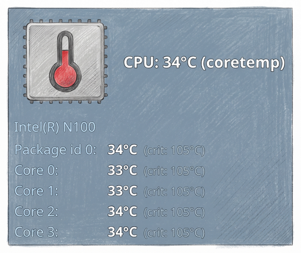
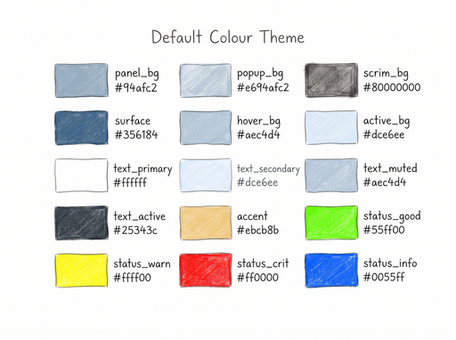

For more than a decade, Xfce4 served as my steadfast daily driver. Every window
behaviour, status applet, and shortcut combination had been honed into pure
muscle memory. Yet beneath that comfortable surface, keeping the environment
consistent across multiple physical workstations had turned into an operational
headache. Replicating setups meant wrestling with brittle XML databases, opaque
settings exports, and fragile custom parsing scripts.

I needed a modern Wayland environment that could replicate the exact look, feel,
and speed of my classic setup without inheriting its maintenance baggage. Over
two intensive weeks, guided by an iterative requirements workflow and powered by
a blend of Claude and Gemini AI models, I migrated my entire workspace to Sway
and QuickShell. The result is an Xfce4 look-alike that honours many years of
reflexes while resting on a clean, declarative, Ansible-managed foundation.

For readers seeking implementation mechanics, compositor directives, and QML
syntax, the companion [technical architecture document][tech-doc] provides an
in-depth operational reference.

## Ditching XML Hell for Plain Text

The catalyst for this migration was automation friction. While Xfce4 remains a
capable desktop environment, managing it at scale through infrastructure as code
is cumbersome. Xfce stores its panel layouts, window properties, and shortcuts
across Xfconf XML trees and configuration dumps.

To automate those configurations with Ansible, I had to maintain bespoke Python
utilities—such as `extract_panel.py` and `extract_shortcuts.py`—just to unpack
XML exports and translate them into manageable playbook variables. A single
upstream property change could quietly fracture the extraction pipeline.

Switching to Sway and QuickShell sweeps away that XML complexity entirely. The
entire desktop is now governed by plain-text, human-readable configuration
files:

- Compositor rules and window logic live in standard Sway text configurations.
- Terminal preferences reside in clean `foot.ini` files.
- Visual components, widgets, and modals are structured as declarative QML.

Because plain text integrates seamlessly with Ansible's native templating
engine, provisioning a new workstation is now a rapid, single-pass idempotent
process. System state can be reviewed in standard version control diffs, and the
entire infrastructure is primed for continuous management via AI-assisted
playbooks.

## Preserving the Classic Vibe: An Xfce4 Look-Alike

A major inspiration for this project came from [Omarchy][omarchy]—shout-out to
the Omarchy team for demonstrating just how cohesive and tailored a modern
Wayland desktop could become! My ambition, however, was conservative by design:
I did not want to reinvent my day-to-day habits. After many years of daily use,
my keyboard shortcuts and panel conventions were second nature. Discarding that
hard-earned efficiency made no sense.

The objective was clear: construct a desktop that feels, looks, and responds
like classic Xfce4, while harnessing the modern display architecture of Wayland.


QuickShell made this aesthetic fidelity possible. Running as a lightweight
layer-shell process, it hosts a 32-pixel top panel that neatly mirrors my
familiar panel anatomy:

1. Keyboard shortcut popup from the Debian crimson swirl.
2. Four-workspace pager supporting direct clicks and scroll-wheel switching.
3. Flat-button window tasklist with dynamic title resolution.
4. Elastic spacer that cleanly separates tasks from status monitors.
5. Clock with calendar launcher.
6. Clipboard Manager.
7. PipeWire audio widget with hover adjustments and volume control.
8. Notification area for system and application alerts.
9. Battery status indicator with detailed power metrics.
10. Wifi connection status indicator with network details.
11. Bluetooth status indicator with connection details.
12. Temperature monitors.
13. CPU load bars.
14. Logout dialogue.

To a casual observer, the workspace looks identical to the GTK-based panel I
used for a decade. To the compositor underneath, it is an ultra-fast,
hardware-accelerated Wayland surface.

## Action-Based Shortcuts: Workflows That Outlive Tools

In conventional desktop environments, hotkeys are tightly bound to specific
application binaries. If you switch terminal emulators, swap system monitors, or
adopt a different email client, you must track down and rewrite disparate
shortcut entries scattered across GUI configuration dialogues.

This setup rethinks keybindings from first principles by organising hotkeys
around user **actions** rather than executable paths.

A single Ansible dictionary serves as the universal source of truth for the
entire system. From this unified registry, Ansible dynamically templates both
the compositor bindings for Sway and the interactive cheat sheet rendered by
QuickShell:

```text
Unified Shortcut Registry (Ansible)
  ├── Sway Configuration (~/.config/sway/config)
  └── QuickShell Modal (Interactive Searchable Overlay)
```

By decoupling user intent from specific tools, individual software components
can be replaced without disrupting physical habits. On my laptop, pressing
`Super + m` spawns Mutt inside a tailored terminal window; on my primary desktop
workstation, the identical key combination opens Thunderbird. The action remains
"open email", and muscle memory remains unbroken.

## Total Control Through Modular Polish

With traditional desktop environments, customising status monitors or tweaking
panel logic meant writing complex C plugins or accepting rigid upstream
defaults. With QuickShell, missing capabilities can be authored directly in
declarative QML.

Instead of bundling all behaviour into an unwieldy panel script, status displays
and interactive metrics are decoupled into standalone components. Tooltips for
battery health, network interfaces, and CPU temperatures function as dedicated,
floating cards.



This architectural control delivered several immediate refinements:

- **Flicker-Free Tooltips:** Pointer movements across the panel utilise a 250ms
  debounce timer, ensuring detailed diagnostic cards appear only when the cursor
  deliberately rests on a widget.
- **Instantaneous Telemetry:** Background shell scripts parse `/proc` and sysfs
  nodes asynchronously, delivering per-core temperature readings in under 15
  milliseconds without stuttering the UI.
- **Harmonious Theming:** A cohesive steel-cerulean palette—derived from Debian
  artwork—is injected globally across QuickShell, Fuzzel application launchers,
  Swaylock security screens, and Sway window borders.



The Foot terminal emulator completes the environment. Running in client-server
mode, it spawns fresh terminal instances in under five milliseconds while
supporting directory inheritance and prompt-jumping out of the box.

## The Iterative AI Workflow: Delivery in Two Weeks

Rebuilding a complete desktop stack—spanning display managers, compositor rules,
layer shells, dynamic tooltips, and shortcut registries—often sounds like an
open-ended rabbit hole. Yet the total elapsed time from the first commit to
daily operational deployment was under two weeks.

That velocity was made possible by pairing a disciplined, test-driven
methodology with a hybrid team of Claude and Gemini language models. Rather than
attempting a monolithic overhaul, the project followed a strict, iterative loop:

1. **Plan:** Author a requirements document outlining the target component.
2. **Review:** Critique architectural trade-offs, edge cases, and dependencies.
3. **Implement:** Apply targeted code changes to Ansible roles or QML scripts.
4. **Test:** Validate execution interactively on real hardware across hosts.
5. **Refine:** Suggest changes and feed discoveries back into the requirements.
6. **Repeat:** Advance deliberately to the next component.

This cadence kept development focused on concrete, testable outcomes. Each
mandatory Xfce4 feature was migrated and verified in isolation before tackling
new enhancements. Once baseline parity was secured, effort turned to surpassing
what Xfce4 could do.

When an edge case emerged—such as preventing background jobs from terminating
when closing a notebook lid, or avoiding race conditions during system tray
initialisation—the solution was codified, reviewed, and deployed idempotently.

## Safe Decommissioning and Retained Foundations

One of the greatest hazards when replacing a core desktop environment is package
decoupling. Purging desktop meta-packages like `task-xfce-desktop` risks
prompting package managers to remove critical shared graphics libraries and
display dependencies.

By approaching package removal declaratively with Ansible, unused GTK components
were systematically purged while preserving vital runtime utilities:

- The original fallback terminal and virtual filesystem integrations were safely
  preserved.
- Unnecessary background daemons and legacy settings daemons were cleanly
  removed.
- System configurations were verified across notebook and desktop hosts alike.

The transition never felt like a chaotic leap of faith. It was a measured,
verifiable evolution that left every workstation cleaner, lighter, and faster
than before.

## The Journey Continues

Replacing a decade-old desktop environment could easily have been a disruptive
exercise in frustration. Instead, it proved to be one of the most rewarding
infrastructure modernisations I have undertaken.

By taking the time to honour the many years of established habits, the new
desktop felt natural on day one. At the same time, shedding legacy XML stores in
favour of plain-text, Ansible-managed configurations has eliminated the friction
of workstation maintenance.

The journey has not ended. With a solid, modular foundation now firmly in place,
future enhancements, performance optimisations, and AI-driven workflow
automations can be introduced effortlessly. The classic vibe remains alive and
well, powered by an agile modern engine.

[tech-doc]: https://github.com/frankhjung/article-markdown/blob/main/wayland/files/desktop.md
[omarchy]: https://omarchy.org
