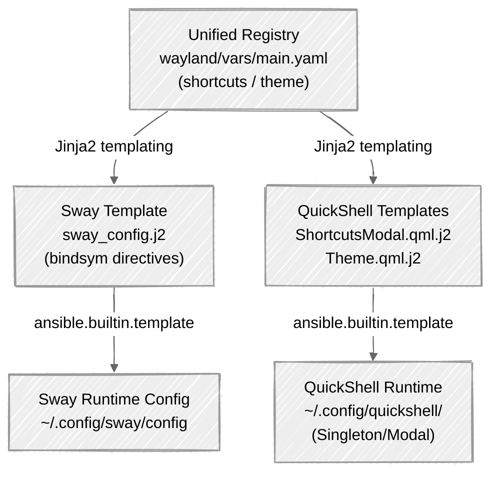
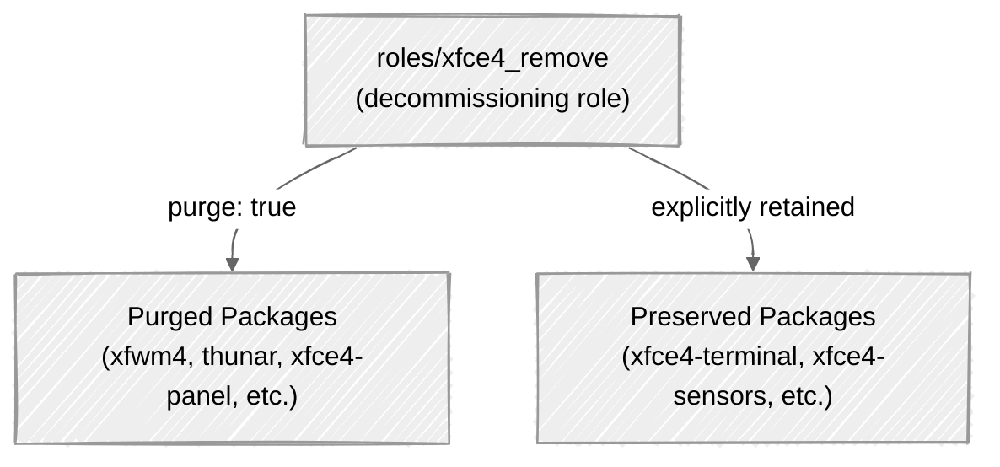

# Replacing a 10-Year Xfce4 Setup with Sway, QuickShell, and Ansible

Rebuilding a desktop environment used for over a decade requires balancing deep
muscle memory with modern graphics architecture. Migrating from a legacy Xfce4
desktop to a modern Wayland compositor stack using Sway and QuickShell solves
this operational challenge without sacrificing established, high-velocity
keyboard workflows. Inspired by my experience using Omarchy, this architecture
shifts system management away from brittle XML export parsing towards
plain-text, Ansible-managed declarative automation across all workstation hosts.
By anchoring system state in simple text files and Jinja2 templates, host
deployment is streamlined while maintaining granular customisation over desktop
aesthetics, panel widgets, and window management.

## The Automation Imperative: Moving from XML Scripts to Plain Text

Managing Xfce4 in an automated infrastructure environment introduces operational
friction. Xfce4 stores its panel, desktop, and keybinding configurations across
Xfconf XML databases and exported XML files. To maintain these setups with
Ansible, custom parsing scripts—such as `extract_panel.py` and
`extract_shortcuts.py`—were required to parse XML exports, translate structures,
and seed configuration parameters back into playbooks.

Migrating to Sway and QuickShell replaces XML abstraction layers with
plain-text, human-readable configuration files (`~/.config/sway/config`,
`~/.config/foot/foot.ini`, and QML files). Plain-text configurations integrate
directly with Ansible's `ansible.builtin.template` and `ansible.builtin.copy`
modules, eliminating translation steps, reducing role dependencies, and making
system rebuilds fast, idempotent, and reliable. Furthermore, maintaining strict
plain-text declarative configurations establishes an environment capable of
being managed via AI-assisted Ansible playbooks.

| Aspect | Legacy Xfce4 | Modern Sway/QuickShell Pipeline |
| :--- | :--- | :--- |
| **Format** | XML databases (Xfconf) | Plain-text (`sway`, `foot.ini`, QML) |
| **Ansible** | Needs Python scripts | Direct Jinja2 templating |
| **Overhead** | High; custom parsing tools | Minimal; native file deployment |
| **Rebuild** | Multi-stage extraction | Rapid, single-pass idempotent runs |
| **Customise** | Pre-compiled C/GTK plugins | Programmable QML components |

## Desktop Architecture & Session Lifecycle

The modernised desktop establishes Wayland as the universal baseline environment
across all managed workstation hosts (`carbonx1`, `geekom`, `thinkbook`). Sway
functions as both the Wayland compositor and window manager, while QuickShell
handles the desktop shell and panel rendering.

### Display Manager and Session Startup Sequence

Display management is handled by LightDM. A configuration drop-in file at
`/etc/lightdm/lightdm.conf.d/60-default-session.conf` sets
`user-session=sway-quickshell` under `[Seat:*]`. The upstream session file
`/usr/share/wayland-sessions/sway.desktop` is diverted via
`community.general.dpkg_divert` to `sway.desktop.distrib`, ensuring that
`sway-quickshell.desktop` is the sole session offered at the greeter and
upgrades do not overwrite this behaviour.

When starting a `sway-quickshell` session, Sway executes a deterministic 11-step
startup sequence:

1. `include /etc/sway/config.d/*` — Import modular compositor drop-in
   configurations.
2. `swaybg -i /usr/share/images/desktop-base/default -m fill` — Render the
   desktop wallpaper.
3. `quickshell` — Launch the QuickShell desktop shell process.
4. `/usr/libexec/polkit-mate-authentication-agent-1` — Initialise the graphical
   PolicyKit authentication agent.
5. `sni-wait nm-applet --indicator` — Launch NetworkManager tray applet after
   the StatusNotifierItem (SNI) host is ready.
6. `sni-wait blueman-applet` — Launch Bluetooth tray applet (conditional on
   Bluetooth inventory group membership).
7. `swayidle -w` — Start the idle management daemon configured via
   `swayidle/config` (locking screen after `wayland_idle_lock_seconds` and
   timing out display power after `wayland_idle_display_off_seconds`).
8. `wl-paste --watch cliphist store` — Start background clipboard history
   monitoring for text and image buffers.
9. `xdg-user-dirs-update` — Synchronise standard XDG user directory paths.
10. `~/.local/bin/resetvolume` — Execute audio volume normalisation script (if
    executable).
11. `xfce4-terminal` — Launch the initial session terminal window.

The `sni-wait` wrapper utility used in steps 5 and 6 prevents startup race
conditions where background tray applets (`nm-applet`, `blueman-applet`) attempt
to register via StatusNotifierItem D-Bus interfaces before QuickShell's SNI host
has finished initialising on the Wayland layer surface.

### Compositor Rules and Window Management

Sway's core window layout rules are defined globally to deliver a clean,
borderless workspace:

```sway
workspace_layout default
default_border none
default_floating_border none
focus_follows_mouse yes
```

A 32px exclusive layer-shell zone is reserved at the top edge of the screen for
QuickShell's top panel. Tiled windows automatically occupy the usable workspace
area beneath this reserved zone. The first tiled window on a workspace fills the
usable space completely, while subsequent windows split the remaining area.
Tiled windows omit title bars and window borders.

Laptop power and display management on notebook hosts (such as `thinkbook`) is
managed at the compositor level using hardware switch bindings:

```sway
bindswitch --reload --locked lid:on output {{ wayland_laptop_output }} power off
bindswitch --reload --locked lid:off output {{ wayland_laptop_output }} power on
```

To prevent background jobs from terminating when closing the laptop lid,
`systemd-logind` is configured via
`/etc/systemd/logind.conf.d/90-wayland-lid-switch.conf` to set
`HandleLidSwitch=ignore`.

Floating window rules are declared dynamically via `wayland_floating_windows` in
`roles/wayland/vars/main.yaml` and templated into `sway_config.j2` for utilities
requiring floating placement, fixed dimensions, or centring:

```sway
# Explicit Floating Window Rules (wayland_floating_windows)
for_window [app_id="xfce4-sensors"] floating enable
for_window [app_id="nm-connection-editor"] floating enable
for_window [app_id="btop"] floating enable
for_window [app_id="mail"] floating enable
for_window [class="(?i)mail"] floating enable
for_window [title="^mail$"] floating enable

# Fixed Initial Geometry for Centred Utilities
for_window [app_id="pavucontrol"] floating enable, \
  resize set 1440 912, move position center
for_window [app_id="blueman-manager"] floating enable, \
  resize set 1440 912, move position center
```

## Building the Panel: QuickShell and Modular Components

QuickShell renders the top status bar via
`roles/wayland/files/quickshell/TopPanel.qml`. The panel spans the full display
width with a total height of 32px, holding widgets with a uniform 30px height to
leave a 1px top and bottom border. Inter-widget spacing is fixed at 2px.


### Top Panel Anatomy

The panel organises 13 distinct widgets in a strict horizontal order, backed by
native QuickShell services or execution binaries:

1. **Session Shortcuts Menu:** Debian crimson swirl emblem (`emblem-debian`)
   that toggles `ShortcutsModal.qml`.
2. **Workspace Pager:** 1-row, 4-workspace pager powered by `Quickshell.I3`
   (`I3.workspaces`), supporting direct clicks and mouse-wheel workspace
   switching.
3. **Window Tasklist:** Flat button task manager powered by `ToplevelManager`.
4. **Expanding Spacer:** Elastic QML spacer (`Item { Layout.fillWidth: true }`)
   pushing operational status widgets to the right.
5. **Clock & Calendar:** Displays time and date (`ddd dd MMM yyyy HH:mm`).
   Clicking invokes `~/.local/bin/calendar-web` to open `wayland_calendar_url`.
6. **Clipboard Picker:** Trigger button invoking `cliphist` and `fuzzel` via
   `~/.local/bin/clipboard`.
7. **Audio Volume & MPRIS:** PipeWire/WirePlumber interface
   (`Quickshell.Services.Pipewire` via `PwObjectTracker`). Left-click opens
   `pavucontrol`, right-click toggles mute, and mouse-wheel adjusts volume.
8. **Notification Popups:** Integrated notification overlay host
   (`NotificationPopup.qml`).
9. **Battery Indicator:** Onboard laptop power monitor powered by
   `Quickshell.Services.UPower` (`UPower.displayDevice`), displayed when UPower
   detects a battery device. Hover statistics are presented by
   `BatteryTooltip.qml`.
10. **System Tray:** StatusNotifierItem (SNI) host
    (`Quickshell.Services.SystemTray`) displaying background system applets
    (`nm-applet`, `blueman-applet`). Detailed network status card is presented
    by `NetworkTooltip.qml` executing `network-status`.
11. **Hardware Temperature Sensor:** Displays CPU package/die temperatures
    (`SensorsWidget.qml`). Executes the `cpu-sensors-status` helper script and
    triggers `SensorsTooltip.qml` on hover.
12. **System Load Bars:** Visual CPU, memory, network, and swap utilisation bars
    (`SysLoadWidget.qml`) parsed from `/proc`. Left-click launches `btop` in
    `foot -W 160x48`.
13. **Logout Action:** Themed lock icon and `Logout...` button that opens the
    headerless `PowerModal.qml` dialogue.

### Modular Tooltips and Interactive Cards

To prevent `TopPanel.qml` from expanding into a monolithic file, detailed
metrics and interactive cards are decoupled into modular QML components:
`BatteryTooltip.qml`, `NetworkTooltip.qml`, and `SensorsTooltip.qml`. Each
tooltip component inherits a standardised floating surface architecture:

- **Debounce Timers:** Cursor movement over panel widgets activates a 250ms
  debounce timer (`hoverTimer`, `netHoverTimer`, `sensorsHoverTimer`). The
  tooltip renders only if the pointer rests on the widget for 250ms, preventing
  visual flicker during pointer transit across the bar. Exiting the widget or
  clicking cancels the timer and dismisses the card immediately.
- **Dynamic Clamping & Positioning:** Tooltips are instantiated as `PopupWindow`
  elements anchored to `panelRoot`. Horizontal coordinates are centred relative
  to the target widget and clamped within screen boundaries:

```javascript
var tipX = targetPoint.x + targetItem.width / 2 - implicitWidth / 2;
var maxTipX = anchor.window.width - implicitWidth - 8;
anchor.rect.x = Math.max(8, Math.min(maxTipX, tipX));
anchor.rect.y = anchor.window.height + 4;
```

- **Background Process Decoupling:** Data collection is offloaded to dedicated
  background scripts executed via `Quickshell.Io.Process`. `NetworkTooltip.qml`
  executes `network-status` to parse link speeds, MAC addresses, drivers, and
  IPv4 addresses into JSON in under 50ms. `SensorsTooltip.qml` executes
  `cpu-sensors-status`, reading `/sys/class/hwmon/` sysfs nodes and
  `/proc/cpuinfo` directly to return per-core temperatures in under 15ms.


### Centralised Icon Resolution

Application and system icon resolution across `TopPanel.qml`,
`WindowSwitcher.qml`, and `BatteryTooltip.qml` is centralised in
`roles/wayland/files/quickshell/IconResolver.js`. `IconResolver.js` eliminates
duplicate resolution logic across the UI stack by handling URI normalisation
(`file://`, `image://`), stripping trailing `.desktop` suffixes, processing
manual application overrides (e.g., mapping `antigravity`, `vscodium`,
`fsearch`, `wdisplays`, `gnucash`, `pavucontrol`), and falling back to
`desktopEntries.byId()` or `desktopEntries.heuristicLookup()`.

## Single Source of Truth: Unified Shortcuts and Theme Architecture

To eliminate configuration drift across the window manager and desktop shell,
all keybindings and colour themes are defined in centralised Ansible data
structures and injected dynamically at playbook execution time.



### The Unified Shortcut Registry (`wayland_shortcuts`)

Keyboard shortcuts are defined inside `roles/wayland/vars/main.yaml` within the
`wayland_shortcuts` dictionary list. Keybindings are indexed by user **actions**
rather than explicit binary execution paths, allowing underlying application
packages to be swapped without changing key combinations:

```yaml
wayland_shortcuts:
  - category: "Applications"
    display_key: "Super + c"
    description: "Terminal emulator (foot)"
    command: "exec foot"
    sway_keys:
      - "Mod4+c"

  - category: "Applications"
    display_key: "Super + m"
    description: "Email client (mutt)"
    command: "exec foot -a mail -T mail -W 160x48 -e mutt -F ~/.muttrc"
    sway_keys:
      - "Mod4+m"
    hosts:
      - "thinkbook"
```

During playbook execution:

1. `sway_config.j2` iterates through `wayland_shortcuts`, filtering by
   `inventory_hostname`, and generates native Sway `bindsym` and `bindsym
   --locked` directives.
2. `ShortcutsModal.qml.j2` converts the identical filtered list into a JSON
   array (`allShortcuts`), populating QuickShell's searchable keybinding
   overlay.

The runtime reloading mechanics differ fundamentally between the window manager
and the desktop shell: QuickShell monitors `~/.config/quickshell/*.qml` via
inotify to instantly hot-reload UI components as soon as Ansible updates
`ShortcutsModal.qml` or `Theme.qml`. Conversely, Sway configuration updates
require explicitly invoking `swaymsg reload` via Ansible handlers
(`handlers/main.yaml`).

### Host-Specific Shortcut Filtering

Shortcuts are conditionally assigned based on hardware form factors and host
roles. To prevent shortcut drift across desktop profiles, `Super + d` (`Mod4+d`)
was chosen as the sole canonical window-list keybinding (`sway-window-helper
window-list`), explicitly retiring redundant bindings like `Super + w`
(REQ-028).

| Key Combination | Action / Application | Host Scope | Sway Binding Command |
| :--- | :--- | :--- | :--- |
| `Super + c` | Terminal | All Hosts | `bindsym Mod4+c exec foot` |
| `Super + d` | Window list | All Hosts | `sway-window-helper window-list` |
| `Super + m` | Email (`mutt`) | `thinkbook` | `foot -a mail ... -e mutt` |
| `Super + m` | Thunderbird | `geekom` | `bindsym Mod4+m exec thunderbird` |
| `Print` | Screenshot (full) | All Hosts | `grim - \| wl-copy -t image/png` |
| `Shift + Print` | Area capture | All Hosts | `grim -g "$(slurp)" - \| ...` |
| `Brightness Up` | Brightness (+5%) | `thinkbook` | `brightnessctl set 5%+` |
| `XF86Calculator` | Octave GUI | `geekom` | `bindsym ... exec octave --gui` |
| `XF86LaunchA` | Display Manager | `geekom` | `bindsym XF86LaunchA ...` |
| `Scroll_Lock` | Lock Screen | `geekom` | `bindsym Scroll_Lock ...` |

### Centralised Wayland Theme Architecture (`wayland_theme`)

The visual colour palette is defined globally within the `wayland_theme`
dictionary in `roles/wayland/vars/main.yaml`. Derived from Debian's desktop
wallpaper palette, it uses a lightened steel-cerulean base (`#94afc2`) to ensure
high contrast against Papirus-Light icons:

```yaml
wayland_theme:
  panel_bg: "#94afc2"
  popup_bg: "#e694afc2"
  scrim_bg: "#80000000"
  surface: "#356184"
  hover_bg: "#aec4d4"
  active_bg: "#dce6ee"
  text_primary: "#ffffff"
  text_secondary: "#dce6ee"
  text_muted: "#aec4d4"
  text_active: "#25343c"
  accent: "#ebcb8b"
  status_good: "#55ff00"
  status_warn: "#ffff00"
  status_crit: "#ff0000"
  status_info: "#0055ff"
```

Theme distribution across the desktop stack is fully automated:

- **QuickShell QML Singleton:** `Theme.qml.j2` templates a singleton object into
  `~/.config/quickshell/Theme.qml`. A companion `qmldir` file registers
  `singleton Theme 1.0 Theme.qml`, enabling QML components to bind directly to
  `Theme.panelBg` or `Theme.textPrimary`.
- **Application Config Templates:** Jinja2 templates derive colours for
  `fuzzel.ini.j2` and `swaylock.conf.j2`. String normalisation via `|
  regex_replace('^#', '')` is strictly applied during rendering because Fuzzel
  expects 8-character RGBA hex strings without hash marks (e.g., `94afc2ff`),
  while Swaylock requires raw hex values without `#` prefixes.
- **Sway Window Borders:** `sway_config.j2` sets window border classes
  (`client.focused`, `client.focused_inactive`, `client.unfocused`,
  `client.urgent`) using Sway's 5-parameter syntax (`border`, `bg`, `text`,
  `indicator`, `child_border`). The fourth parameter (`indicator`) explicitly
  binds `wayland_theme.accent` to set the container split boundary colour,
  providing critical visual feedback when splitting tiled containers even when
  standard window borders are disabled (`default_border none`).
- **System Toolkits:** Desktop interface preferences are written via
  `community.general.dconf` to `/org/gnome/desktop/interface/color-scheme`.


## Terminal Ecosystem and Safe Xfce4 Decommissioning

### Terminal Workflow with Foot

`foot` is deployed as the primary Wayland terminal emulator due to its low
resource footprint, fast rendering, and native support for wlroots protocols:

```ini
# ~/.config/foot/foot.ini
[main]
font = monospace:size=11
pad = 6x6 center

[scrollback]
lines = 10000

[url]
launch = xdg-open ${url}
```

- **Server/Daemon Mode:** Sway initialises `foot --server` at startup.
  Subsequent terminal executions invoke `footclient`, spawning new terminal
  windows in under 5ms while sharing font caches in memory.
- **Terminal Protocol Integrations:** `foot` implements key OSC escape protocols
  for advanced shell interaction:
  - **OSC-7 (Directory Tracking):** Transmits current working directory updates
    from the shell, enabling `Ctrl + Shift + n` to spawn new terminal windows
    directly in the parent terminal's active working directory.
  - **OSC-133 (Prompt Integration):** Emits prompt boundary markers (`OSC-133;A`
    at prompts, `OSC-133;C` at command execution, `OSC-133;D` at command
    completion). This enables prompt-jumping via `Ctrl + Shift + z` / `Ctrl +
    Shift + x` and last-command output piping via `Ctrl + Shift + g`.
- **Built-in Navigation Modes:** Includes scrollback search (`Ctrl + Shift + r`)
  and URL mode (`Ctrl + Shift + o`), which highlights visible URLs with keyboard
  jump labels.
- **Container Integration:** Rather than handling internal window tabs, `foot`
  delegates tab management to Sway. Configuring `workspace_layout tabbed` or
  `for_window [app_id="foot"] layout tabbed` places new terminal windows into
  native Sway tabbed containers.

### Safe Package Preservation and APT Purging

Retiring Xfce4 across managed hosts required purging unused GTK/X11 packages
without breaking shared runtime dependencies relied upon by Sway and QuickShell.
Decommissioning was handled declaratively by the decommissioning role
`roles/xfce4_remove` prior to its complete retirement in REQ-026.



Under Debian Testing, enforcing `autoremove: false` alongside `purge: true` in
`roles/xfce4_remove` was a critical safety constraint. Purging desktop
metapackages like `task-xfce-desktop` causes APT to misidentify fundamental
X11/Wayland support libraries (`xorg`, `x11-apps`) as unreferenced orphans;
executing an autoremove pass would inadvertently wipe out these essential
graphics stack components.

1. **Packages Purged:** `xfce4`, `xfwm4`, `thunar`, `xfce4-panel`,
   `xfce4-session`, `xfce4-power-manager`, `xfdesktop4`, `ristretto`,
   `task-xfce-desktop`, `xfce4-notifyd`, and related panel plugins.
2. **Packages Preserved:**
   - `xfce4-terminal`: Preserved as the initial fallback session terminal.
   - `xfce4-sensors-plugin`: Preserved to provide the configuration interface
     for QuickShell's `SensorsWidget.qml`.
   - `gvfs`: Preserved to maintain virtual filesystem and trash integration for
     `pcmanfm-qt`.
3. **User Configuration State:** `~/.config/xfce4/panel/` is purged, whereas
   `~/.config/xfce4/terminal/terminalrc` is explicitly retained.

## Key Takeaways & Operational Benefits

- **Preserved Muscle Memory:** Retains keybindings, panel ordering, and
  operational workflows honed over 10+ years of Xfce4 usage, eliminating user
  retraining.
- **Declarative Automation:** Replaces brittle XML export parsing scripts with
  standard, maintainable Ansible Jinja2 templates and plain-text configuration
  files.
- **Reduced Complexity & Machine Rebuilds:** Simplifies host provisioning across
  physical desktops and laptops, ensuring fast, idempotent system deployments.
- **Enhanced Control:** Decouples panel widgets into modular QML components
  (`BatteryTooltip`, `NetworkTooltip`, `SensorsTooltip`), providing exact
  control over desktop UI and layout behaviour.
- **AI-Managed System State:** Establishes a clean, plain-text configuration
  baseline ready for AI-assisted infrastructure management via Ansible
  playbooks.
